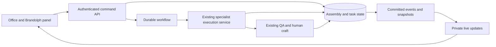

# Brand OS agency office implementation plan

Research date: 7 October 2026. Proposal only; application code is unchanged.

## Recommendation

Replace the canvas presentation with a living agency office. Brandolph is the visible orchestrator; existing specialists appear as staff, receive assignments, and produce the existing deliverables. Keep business execution authoritative on the server and render movement locally in the browser.

Ship a preset office and one complete production workflow first. Add office customization after reliable background execution and reconnect are working.

## Research evidence

Pixel Agents was inspected at commit `3537e140c2094761beae748592aeb92ece8edfdd` from a shallow clone in `/tmp/brandos-pixel-agents-research`.

- The project provides a React interface, Canvas 2D engine, character animation, grid pathfinding, office editor, and JSON layouts. It supports a browser interface and VS Code adapter. [Project README](https://github.com/pixel-agents-hq/pixel-agents/blob/3537e140c2094761beae748592aeb92ece8edfdd/README.md).
- Its normalized event contract includes session, tool, subagent, progress, and permission events. The concrete provider is Claude Code; a Brand OS integration needs its own domain adapter. [Provider contract](https://github.com/pixel-agents-hq/pixel-agents/blob/3537e140c2094761beae748592aeb92ece8edfdd/core/src/provider.ts).
- The renderer and game loop operate in the browser. Reusable modules include `office/engine`, `office/layout`, `office/editor`, sprite caches, and projection helpers. The office component imports its transport, so extraction requires separating that dependency. [Game loop](https://github.com/pixel-agents-hq/pixel-agents/blob/3537e140c2094761beae748592aeb92ece8edfdd/webview-ui/src/office/engine/gameLoop.ts), [office component](https://github.com/pixel-agents-hq/pixel-agents/blob/3537e140c2094761beae748592aeb92ece8edfdd/webview-ui/src/office/components/OfficeCanvas.tsx).
- MIT permits adaptation with its notice retained. The README credits third-party character artwork: confirm terms for any assets carried over, or commission original Brand OS assets. [License](https://github.com/pixel-agents-hq/pixel-agents/blob/3537e140c2094761beae748592aeb92ece8edfdd/LICENSE).
- Orchestrator characters and interactive task handoffs are described as future work in the README. Reusing the renderer does not supply production orchestration.

## Existing Brand OS integration points

These observations concern the local CaastorOS checkout, used here as the Brand OS implementation. Production deployment configuration and actual capacity were not audited.

| Existing file | Observed responsibility | Proposed change |
| --- | --- | --- |
| `src/portal-brandolph.jsx` | Sends brief, crew, and delivery plan to the canvas via session storage | Persist an assembly and navigate using its ID |
| `src/portal-briefs.jsx` / `BriefRunCanvas` | Browser sequences specialist runs and paired copy/image work | Extract shared run/output UI; replace execution loop with server commands and subscriptions |
| `src/portal-briefs.jsx` / `BriefViewCanvas` | Reopens persisted brief outputs | Load the same outputs into office/project review |
| `src/portal-shell.jsx` | Hosts the canvas route | Mount an office workspace behind a feature flag |
| `src/portal-data.js` | Lists specialist IDs, names, departments, and credits | Map IDs to visual identities; use active server specs for authoritative availability |
| `server/src/routes/runs.js` | Executes one specialist with BIO gate, streaming, QA, persistence, credit accounting | Extract a reusable execution service callable by routes and background workers |
| `server/src/lib/delivery-plan.js` | Validates delivery groups, crew, platform, and count limits | Build an explicit task dependency graph from validated plans |
| `server/src/routes/inngest.js` | Registers BIO compilation and notification workflows | Register assembly and specialist execution workflows |
| `server/src/lib/credits.js` | Reserves and settles credits for runs | Preserve atomic accounting and add assembly/task idempotency |

## Office layout and art

Use one office per workspace with a selected brand and project. Department zones remain stable; only the crew relevant to the current project needs to be prominent.

Initial zones:

- Brandolph at a central coordination desk.
- Strategy and Concept beside a brief/idea board.
- Copy at writing desks.
- Visual at a studio bench.
- Web & UX at a build station.
- QA and human craft at a review area.
- An output shelf for completed work.

Layouts are versioned JSON containing dimensions, floor/wall tiles, furniture, department areas, seats, and semantic anchors such as the brief board and output shelf. Store overrides by workspace, with a revision for optimistic concurrency. Validate size, asset IDs, walkable routes, and usable seats server-side. Layout editing should never invalidate a running job.

Start with a compact preset. Later add two larger templates and an editor for furniture, colors, and department zones. Generate desks deterministically from crew size rather than asking an LLM to invent a new floor plan on every run.

Create one original sprite family with a consistent grid and camera angle. Include directional walking, seated work, reading/review, idle, and attention states. Assign specialists stable outfits, accessories, labels, and department colors. Brandolph gets a distinct silhouette. Static reusable art has no per-run generation charge.

Adapt the selected Pixel Agents rendering/editor modules into a pinned internal package with attribution and upstream provenance. Audit its React 19 assumptions before integrating with Brand OS's current React 18 app; do not assume the complete upstream UI is a drop-in component.

## Agent identity and truthful activity

Separate three identities:

1. Specialist definition: existing specialist ID, active spec version, role, tools, model routing, and credit estimate.
2. Task execution: task ID, run ID, attempt, dependencies, output IDs, and status.
3. Visual staff member: appearance, home department, preferred desk, and selected task.

A character represents an existing capability, not a continuously running AI process. Instantiate compute only for scheduled work. A specialist may handle multiple deliverables: show a task queue or explicit temporary worker instances when simultaneous tasks need to be visible.

| Authoritative state | Office representation |
| --- | --- |
| Assigned/queued | Assignment badge; waiting at a desk |
| Waiting for dependency | Clear dependency label |
| Running | Work animation with current task label |
| QA/review | Reviewer activated; output awaiting verdict |
| Needs user input | Attention bubble linked to an actionable panel |
| Approved/complete | Output added to shelf |
| Flagged | Output marked for revision |
| Failed/retrying | Error/retry badge with reason |
| Cancelled | Work animation stops; result state remains explicit |

Transitions can animate a brief moving from Brandolph to the specialist and outputs moving into review. Never delay execution while a character walks. Fast jobs can finish mid-animation; authoritative status wins. Use stage labels or completed task counts rather than inventing percentage completion from elapsed time or generated tokens. Display task summaries and observable tool activity, not private model reasoning.

## Interface

- Top bar: brand, project, execution state, completed/total tasks, credits, and primary action.
- Center: pan/zoom office with visible department labels and active crew.
- Brandolph panel: submit/refine brief, inspect plan, start work, and answer questions.
- Agent inspector: task, status, dependencies, output preview, and revision/rerun controls.
- Output tray: deliverables that open existing review, export, and human craft flows.
- Activity feed: durable assignment, handoff, review, retry, and completion history.

Include keyboard-accessible staff/task lists and a reduced-motion mode. On narrow screens use a focused room plus task/output lists. Keep BIO context, approvals, attribution, and output editing easy to reach. The office becomes the main execution surface; detailed output editing remains a normal panel.

## Execution architecture

Suggested additions:

- `assemblies`: workspace, brand, brief, pinned BIO/plan versions, status, budget, creator, cancellation request.
- `assembly_tasks`: specialist/spec version, dependency IDs, input/output references, status, attempt, idempotency key.
- `assembly_events`: ordered durable state events, actor/task IDs, timestamps, minimal payloads.
- `office_layouts`: workspace template, schema version, revision, JSON overrides.
- `office_staff_preferences`: stable visual identity and desk preferences.

Suggested API: create assembly; start assembly; get snapshot; list events after sequence; request cancellation; revise or retry a task; save layout with expected revision. Workspace authorization applies to every command, snapshot, output, and subscription.

Build dependencies explicitly, including copy-to-image slots and production-to-QA. Initially migrate the existing ordering; enable parallel execution only for tasks whose inputs are ready. Pin upstream output references so retries and parallel jobs receive reproducible context. Existing implicit 'all prior outputs' loading needs adaptation for this graph.

Extend Inngest rather than introducing a second queue immediately. Its documentation supports keyed tenant concurrency and global concurrency controls. Configure task concurrency by workspace and provider, along with rate/token budgets and worker capacity. A concurrency cap alone does not enforce tokens per minute. [Inngest concurrency](https://www.inngest.com/docs/guides/concurrency).

Extract specialist execution from the HTTP streaming handler; background jobs must not depend on a browser connection. Persist run/output/credit settlement and the event/outbox entry transactionally. Deliver events with retries and consumer deduplication. Use unique task-attempt keys and provider idempotency/reconciliation where available: durable retries alone do not guarantee exactly-once paid provider calls. Cancellation is cooperative and provider-specific; completed usage still needs settlement.

Events include `assembly.started`, `task.assigned`, `task.started`, `task.progress`, `task.output_ready`, `task.qa_result`, `task.needs_input`, `task.failed`, and `assembly.completed`. Carry workspace/brand/assembly/task IDs, sequence, and timestamps. Restrict publisher permissions to the backend; browsers send authorized commands rather than authoritative state broadcasts.

Use private Broadcast channels scoped to assembly/workspace membership. Supabase recommends Broadcast for most database subscription use cases. Fetch an authoritative snapshot on open/reconnect, buffer incoming events during snapshot loading, then apply only newer sequence numbers. Detect gaps and refetch/replay from application storage. [Supabase Broadcast guidance](https://supabase.com/docs/guides/realtime/subscribing-to-database-changes).

Stream text only to an open output inspector and batch its updates. Office subscribers receive status transitions and throttled summaries. Sprite positions and animation frames remain local; there is no server office simulation or dedicated VM per office.

## Scale model

Registered users, connected viewers, running assemblies, and concurrent provider calls are separate capacity metrics. A 10,000-user account base may need far less infrastructure than 10,000 simultaneous viewers or 10,000 simultaneous jobs.

Illustrative sizing assumption: one viewer per office, 20% of connected offices running, up to three eligible model tasks per running assembly, and two outgoing office updates per running office per second.

| Connected users | Running offices | Requested concurrent model tasks | Outgoing office updates/second |
| --- | ---: | ---: | ---: |
| 100 | 20 | 60 | 40 |
| 1,000 | 200 | 600 | 400 |
| 10,000 | 2,000 | 6,000 | 4,000 |

These are workload assumptions, not measured capacity or a promise to run every eligible task immediately. Queue model work to a global budget. At 500 bytes/update the last row is about 2 MB/second or 7.2 GB/hour of outbound payload before protocol overhead. Additional viewers/tabs amplify delivery; token streaming and heartbeat/join traffic add load.

As of the research date, Supabase lists 500 connections/500 messages per second for Pro, and 10,000 connections/2,500 messages per second for Pro without spend cap and Team. Enterprise lists configurable higher limits. The 4,000-update example exceeds the listed 2,500-message ceiling before additional traffic. Arrange higher quotas, reduce/batch updates, or move live delivery to a separately scaled gateway if measurement warrants it. Re-check quotas at deployment. [Current limits](https://supabase.com/docs/guides/realtime/limits).

Deployment progression:

- 100 concurrent users: CDN assets, existing API/database stack, durable background execution, private updates, strict provider/task limits, and basic telemetry.
- 1,000 concurrent users: API/worker replicas where needed, measured database indexes and pooling, queue fairness, quota upgrades, and reconnect/load tests.
- 10,000 concurrent users: negotiated realtime and workflow capacity, worker scaling by measured queue lag and provider budgets, connection-storm testing, event retention/partitioning if needed, and tenant isolation tests. A dedicated realtime gateway is an option, not an automatic requirement.

Rendering cost depends on characters visible in one office, not total users. Benchmark 10, 30, and 60 characters; cap simultaneously visible workers and summarize excess work. Cache static room layers, pause offscreen/hidden animation, and offer reduced motion. Adopt a different renderer only if actual device profiling warrants it.

AI cost depends on assemblies per day, specialist tasks per assembly, model usage, image generation, QA, and retries. The office adds client rendering and live-delivery costs; it need not add AI calls. Budget estimation requires actual usage and provider contracts rather than user count alone.

## Delivery sequence and acceptance gates

1. **Rendering spike and art direction.** Adapt the engine with one preset, Brandolph, Copy, Visual, and QA. Feed recorded synthetic domain events through an adapter. Measure bundle, memory, and low-end rendering; confirm asset provenance. Clearly mark the spike as simulated.
2. **Durable execution.** Extract the run service, persist assemblies/tasks, and migrate a social campaign flow with copy-to-image dependencies and QA. Verify closing/reopening the browser, interrupted workers, retries, cancellation, and accounting without duplicate settlement.
3. **Production office UI.** Connect real events, output tray, inspectors, activity history, credits, BIO gate, human craft, accessible controls, and narrow-screen layouts. Roll out behind a workspace flag, then make it the main surface after pilot validation.
4. **Customization.** Add template selection, saved department seating, layout editing, validation, and revision conflict handling.
5. **Scale certification.** Exercise 100, 1,000, and 10,000 viewer connections with synthetic provider adapters; run a separate controlled paid-provider sample. Test both normal traffic and synchronized reconnects. Establish achievable queue-time targets under provider quotas.

Provisional estimate: a rendering spike takes roughly 3–5 engineering days; a production pilot roughly 3–5 weeks with two engineers and part-time design; customization and scale hardening roughly another 2–4 weeks. These are planning estimates, dependent on engine extraction, art scope, current backend behavior, and provider capacity. Load testing may require paid infrastructure and negotiated limits.

Release gates: real assignment/status accuracy; jobs independent of open tabs; recoverable outputs; credits settle once; no cross-workspace subscriptions or access; explicit dependency correctness; no misleading completion state; accessible equivalent controls; and measured client/server performance at the intended deployment tier.

Proposed initial targets to validate: office status visible within two seconds at p95 after commit; at least 30 FPS with 30 visible characters on an agreed baseline device; successful snapshot recovery under reconnect storms; zero lost terminal states and zero duplicate credit settlements in failure-injection tests. These are acceptance targets, not current measurements.

## First vertical slice

A user asks Brandolph for three social posts with images. Brandolph proposes the existing crew and credit estimate. The user starts the assembly; Copy receives the task; Visual starts each dependent image when its source copy is available; QA flags or approves items; approved deliverables appear on the output shelf. Closing the browser during generation does not interrupt scheduling, and reopening shows the persisted result.

That slice proves the office, existing Brand OS logic, execution reliability, and useful output interaction together.
