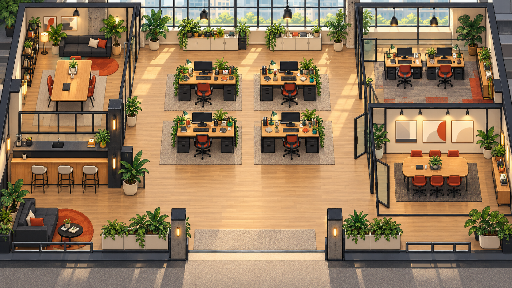
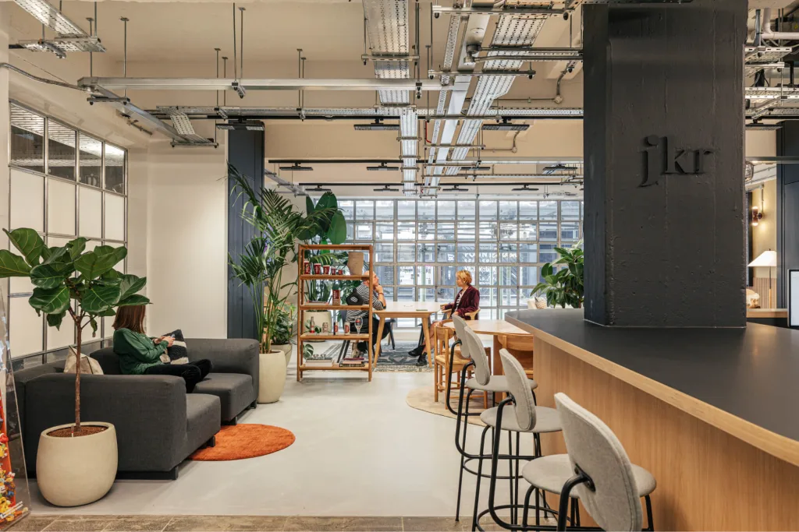
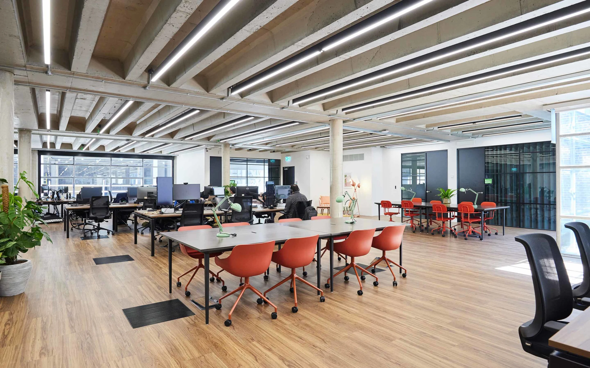
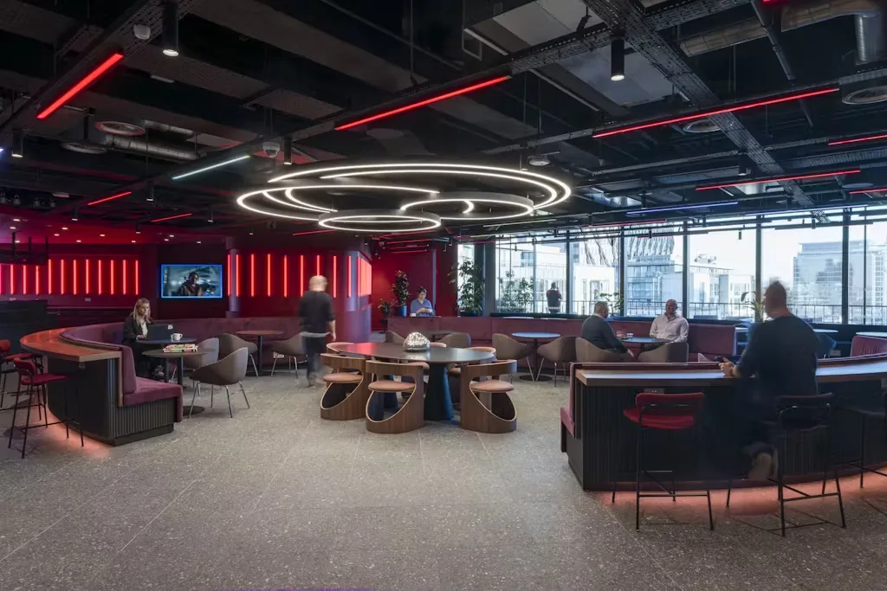
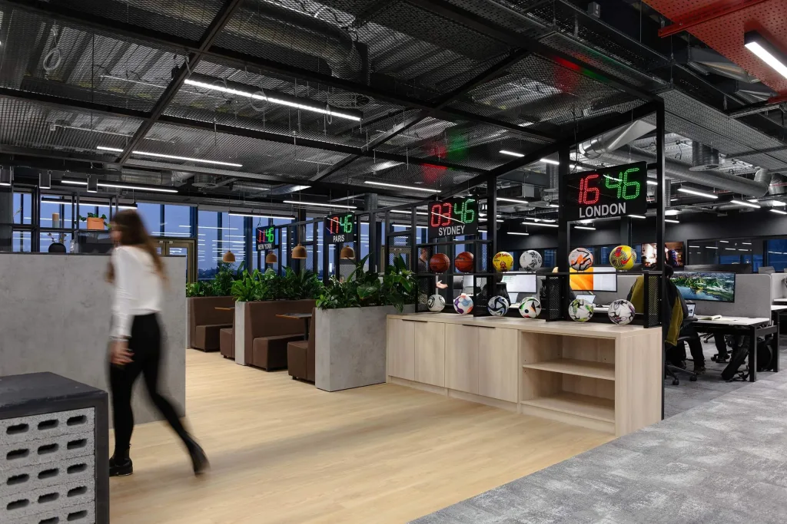
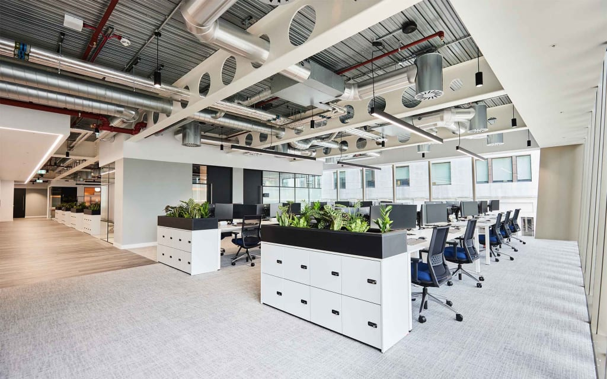

# Brand OS boutique agency — complete asset generation guide

Version 1 · October 8, 2026

This guide is for generating an ORIGINAL modular creative-agency office and human specialists, one asset at a time. It includes the exact references to attach, copy-ready prompts, proposed native dimensions, pose requirements, delivery filenames, and the checks we will use before integration.

The existing polished office image is our visual target. It is a furnished composition, not a modular asset pack. The new assets will let users add/remove frames, replace desks, equip workstations with laptops, divide rooms, and personalize their agency. Task movement must follow actual assignments and output handoffs.

## 1. How to use this document

1. Open the reference image files included in the `references` folder. Attach the specified files to each image-generation request; text references to R00 alone do not provide the image to the model.
2. Copy the entire prompt block for ONE asset. Do not generate a collage unless the block explicitly asks for a diagnostic sheet.
3. Start with P01–P06. Share those results so we can check one room shell, desk, chair, computer, and character together. This is the highest-value pause point: fix scale/perspective once before generating dozens of pieces.
4. Use each accepted result as an additional reference when a later prompt says “approved desk,” “approved chair,” or “approved character.” Keep R00 as the overall style reference.
5. Save the original generated file without cropping or compression. Use the specified filename, even if the image is larger than the native target. Share the full-resolution files; screenshots are insufficient for alpha/frame inspection.
6. Exact small pixel dimensions are a PRODUCTION TARGET, not a guarantee from an image model. Large renders may need pixel cleanup, alpha correction, snapping to the grid, and sprite-sheet assembly. We will do that inspection and integration after receiving the originals. A sheet that looks plausible is not automatically animation-ready.

## 2. Reference images to attach

The real-office photographs are material/design references, not backgrounds to trace. Keep the original camera and style of R00. Do not copy photographs' people, logos, signage, or exact floorplan. Do not attach the Star Office repository artwork to these generations: we are creating our own pack.

### R00 — Approved Brand OS studio

Primary reference for every generation: camera, furniture scale, light, color, and environment.



[Open full-resolution R00](references/R00-approved-studio.png)

### R01 — Lounge, oak and plants

Lounge furniture, oak cabinetry, plant shapes, warm hospitality.



[Open full-resolution R01](references/R01-lounge-oak-plants.png)

### R02 — Desks, orange chairs and glass rooms

Workstation details, orange chairs, glass partitions and collaboration tables.



[Open full-resolution R02](references/R02-desks-orange-chairs-glass.png)

### R03 — Social lounge and lighting

Small lounge clusters and restrained accent light. Do not reproduce the dark nightclub atmosphere.



[Open full-resolution R03](references/R03-social-lounge-lighting.png)

### R04 — Partitions, display and storage

Black frames, display shelves, planter dividers. Do not reproduce logos, footballs, city signs, or clocks.



[Open full-resolution R04](references/R04-partitions-display-storage.png)

### R05 — Workstations and planter storage

Ergonomic chairs, desk clusters, cream cabinets, greenery, bright daylight.



[Open full-resolution R05](references/R05-workstations-planter-storage.png)

## 3. Shared production contract

### Camera and materials

Use R00's orthographic three-quarter top-down cutaway camera: rectangular room, horizontal rear walls, visible tabletop and furniture fronts, straight verticals, no isometric diamond. Objects must share its viewing angle. Ground footprints remain rectangular even when the visible furniture includes height above them.

Palette: cream plaster `#EAE3D3`, pale concrete `#B8B8AE`, oak `#B88754`, charcoal steel `#303735`, burnt orange `#BE623E`, sage `#7F9270`, amber `#D5AD62`. These are starting palette anchors, not mandatory flat fills. Concentrate contrast around silhouettes and screens. Floor texture stays quiet. Avoid smooth photographic textures and soft gradients; use intentional pixel clusters. R00 is richer than strict retro pixel art: new pieces must be tested beside it before we lock their final pixel density.

Light comes from upper-left/back windows. Do not bake large cast shadows into furniture. Small contact shading may stay inside the asset; directional shadows should be separate later. No text, UI labels, logos, watermarks, people in furniture/background assets, franchise imagery, or decorative servers.

### Grid, scale and output

Proposed world grid: 32×32 native pixels. Room shell target: 1280×768, 40×24 tiles. This is a new modular-scene target, not an instruction to stretch the current 1672×941 background. Character cells: 32×64. The current prototype uses 16×32 characters, so these new sprites require an adapter; they are not drop-in replacements.

Every isolated object uses a truly transparent PNG. A checkerboard DRAWN into the image is not transparency. No white matte, glow halo, or padding of a different color. Keep transparent padding sufficient for the stated cell without changing the object scale. If transparency is unavailable, deliver the unmodified original and identify that limitation; do not flatten it on white.

Dimension notation below is WIDTH × HEIGHT. Footprint is floor occupation/collision; image size also includes vertical height. Our integration manifest, not the generator, will define footprints, seats, tabletop anchors, wall mounting, and grouping.

Initial targets:

| Family | Native target | Notes |
|---|---|---|
| Desk | 128×96 | 4×2-tile proposed footprint; foreground fascia may be split later |
| Chair | 32×48 | 1×1-tile footprint; separate sprite behind seated person |
| Character | 32×64 | One pose per cell; no furniture baked in |
| Laptop/monitor | 32×32 / 32×48 | Desktop attachments; not floor collision objects |
| Keyboard/mouse/tablet | 32×16 / 16×16 / 48×32 | Desktop attachments |
| Wall frame | 64×64 | Separate frame and user-content aperture |
| Door/partition | 64×96 | Structural placement; variants needed for adjacency/orientation |

### Sitting and working: important

The person and chair are separate. The desk and its equipment are separate. A seated pose must face the screen and make the pelvis, feet, shoulders, and hands fit the approved chair/workstation. Do not generate a seated person together with a complete desk; that would prevent changing desks.

We need a back-facing working pose for a character seated below the desk and looking toward the upper edge of the screen, plus a right-facing pose for a side workstation. Left-facing may be mirrored only if hair/accessories remain acceptable. A front-facing seated pose is useful for the opposite side of a meeting table. Sitting transitions must lower the pelvis naturally and bring the hands to typing position, rather than jump between standing and a floating torso.

Desk front/fascia, chair, body, hands, screen, and small accessories may require separate depth layers after cleanup. The generator must preserve recognizable body parts; we will establish final numeric seat/hand anchors after the P06 fit test. Do not commission all animation frames against an untested anchor.

## 4. Generation order and references

P01: empty room shell. P02: oak desk. P03: orange chair. P04: laptop. P05: Brandolph standing. P06: Brandolph seated WORKSTATION FIT STUDY. These six establish the art direction and seat fit.

Then P07–P12: remaining workstation equipment and alternate desk/chair. P13–P24: modular architecture, framing, decoration, and functional areas. P25–P30: specialist standing concepts. P31–P35: reusable pose/animation generation and integration checks.

Approval means visual selection in our conversation, not an external approval workflow. If we choose a variant, keep it as the reference for downstream generations.

## 5. Copy-ready generation prompts

### P01 — Empty studio shell

**Attach:** R00, R02, R05.

**Save as:** `ENV-01-empty-studio.png`. **Production target:** 1280×768; concept/background.

**Copy this entire prompt:**

```text
Create an ORIGINAL empty architectural shell for the Brand OS studio shown in R00. Preserve the character of the space: daylight rear windows, oak floor, cream/concrete walls, black structural frames, a briefing room at left, broad central production floor, QA room at upper right, and presentation room at lower right. Remove EVERY desk, chair, computer, sofa, meeting table, plant, cabinet, artwork, rug, and small object. Keep only permanent architectural elements. No people. Make doorways wide and circulation continuous: lower corridor connects departments, central floor remains open for four workstations, right rooms have openings that do not require crossing a wall. Show the full rectangular cutaway, no roof, no exterior landscape consuming the canvas. Floor grain must be quiet enough for sprites and selection markers. Native target 1280×768 with a proposed 32px modular grid, no perspective distortion. This background is opaque. Do not add labels, bed, kitchen appliances, logos, or server cabinets. Match R00’s visual richness without keeping its movable furnishings. Return one clean image, not a before/after comparison.
```

**Check before continuing:** No movable furnishings remain; room connections and empty work areas are clear. The camera matches R00, and the shell does not copy a residential floorplan.

### P02 — Oak workstation desk

**Attach:** R00, R02, R05.

**Save as:** `WORK-01-desk-oak.png`. **Production target:** 128×96; footprint target 4×2 tiles.

**Copy this entire prompt:**

```text
Create an original asset for Brand OS, a boutique creative agency simulation. Use the attached approved studio image R00 as the primary style reference. Match its orthographic three-quarter top-down camera, rectangular geometry, warm oak/cream/charcoal materials, burnt-orange accents, sage plants, and light from upper-left/back windows. Use readable intentional pixel clusters and consistent object scale; no isometric diamond, photorealism, smooth gradients, vector-flat icon style, or change of camera. No logos, text, watermark, border, UI, people, or extra scenery. Do not reproduce identifiable reference-office branding. The delivered isolated production asset must be a transparent PNG with clean alpha, crisp edges, no baked checkerboard or white matte, and no large cast shadow. Keep the complete object inside its cell. This is one asset, not a collage or multiple alternative designs. Subject: one unoccupied oak agency desk, front-facing to the viewer in the approved top-down camera. Warm oak rectangular top, charcoal steel legs, modest drawer pedestal on one side, rounded only slightly at the corners. Native target 128×96. Leave the tabletop entirely clear so a laptop, monitor, keyboard, lamp, and papers can be attached separately. The top should occupy enough of the image to read as a working surface, with a narrow readable front edge. A person in a 32×64 cell must fit at its front-center seat. Do not include chair, person, laptop, plant, wall, floor patch, or background. Keep leg and pedestal details readable at native size. Do not bake a huge shadow below the desk. This is the master workstation whose proportions all later equipment and seated poses must match.
```

**Check before continuing:** One isolated object; alpha is real; no neighboring objects; camera and relative scale match approved desk and room; important details remain readable when small.

### P03 — Orange ergonomic chair

**Attach:** R00, R02, approved P02 desk.

**Save as:** `WORK-02-chair-orange-front.png`. **Production target:** 32×48; 1×1-tile footprint.

**Copy this entire prompt:**

```text
Create an original asset for Brand OS, a boutique creative agency simulation. Use the attached approved studio image R00 as the primary style reference. Match its orthographic three-quarter top-down camera, rectangular geometry, warm oak/cream/charcoal materials, burnt-orange accents, sage plants, and light from upper-left/back windows. Use readable intentional pixel clusters and consistent object scale; no isometric diamond, photorealism, smooth gradients, vector-flat icon style, or change of camera. No logos, text, watermark, border, UI, people, or extra scenery. Do not reproduce identifiable reference-office branding. The delivered isolated production asset must be a transparent PNG with clean alpha, crisp edges, no baked checkerboard or white matte, and no large cast shadow. Keep the complete object inside its cell. This is one asset, not a collage or multiple alternative designs. Subject: one burnt-orange ergonomic office chair, empty, positioned as if behind a person sitting at the FRONT-CENTER of the approved desk. Native cell 32×48. Match the photographed orange chair character using a compact backrest, readable seat, charcoal support and a restrained five-spoke caster base. The seat plane must fit a seated 32×64-character pelvis. Show the camera-facing front view of the chair; the backrest must remain visible above/beside the seated torso once layered. No human body, hands, clothes, desk, equipment, or surrounding floor. Keep seat and backrest clearly distinguishable rather than a single orange blob. Attach the approved desk only to establish scale and camera; do not render it in this output. Center the chair consistently for future directional variants.
```

**Check before continuing:** One isolated object; alpha is real; no neighboring objects; camera and relative scale match approved desk and room; important details remain readable when small.

### P04 — Open laptop

**Attach:** R00, approved P02 desk.

**Save as:** `WORK-03-laptop-open.png`. **Production target:** 32×32; tabletop attachment.

**Copy this entire prompt:**

```text
Create an original asset for Brand OS, a boutique creative agency simulation. Use the attached approved studio image R00 as the primary style reference. Match its orthographic three-quarter top-down camera, rectangular geometry, warm oak/cream/charcoal materials, burnt-orange accents, sage plants, and light from upper-left/back windows. Use readable intentional pixel clusters and consistent object scale; no isometric diamond, photorealism, smooth gradients, vector-flat icon style, or change of camera. No logos, text, watermark, border, UI, people, or extra scenery. Do not reproduce identifiable reference-office branding. The delivered isolated production asset must be a transparent PNG with clean alpha, crisp edges, no baked checkerboard or white matte, and no large cast shadow. Keep the complete object inside its cell. This is one asset, not a collage or multiple alternative designs. Subject: one open charcoal laptop on an implied desktop. Native target 32×32. Screen faces a person who will sit at the lower/front edge of the desk, with the keyboard on the lower half of the laptop and the upright screen above it. Match the desk’s camera and tilt. Display a calm cream/ink-blue screen with abstract content blocks but NO readable letters, brand logos, or app interface labels. Keep hinge, screen frame, keyboard deck, and touchpad readable. Screen must not look like a television or a floating rectangle. Desk surface, person, hands, cables, furniture and floor are absent. The laptop is an independent transparent attachment that users can place on different desks. Do not rotate the camera or enlarge it into a hero product illustration.
```

**Check before continuing:** One isolated object; alpha is real; no neighboring objects; camera and relative scale match approved desk and room; important details remain readable when small.

### P05 — Brandolph identity — standing

**Attach:** R00, approved P02 desk.

**Save as:** `CHAR-01-brandolph-stand-down.png`. **Production target:** 32×64 character cell.

**Copy this entire prompt:**

```text
Create one original HUMAN specialist for the Brand OS boutique agency. Use R00 for camera, lighting, palette restraint, and visual richness; use the approved Brandolph character as the proportional reference when available. Orthographic three-quarter top-down character, facing DOWN toward the viewer, neutral standing pose. Native cell target 32×64; one consistent ground-contact baseline, readable head/torso/legs, compact natural adult proportions suitable for a pixel-office game. Intentional pixel clusters, crisp silhouette, no smooth photographic rendering, no anime portrait, no creature or mascot. Transparent PNG, clean alpha, no floor, chair, desk, shadow extending outside the cell, UI, text, name label, logo, watermark, props outside the cell, or multiple poses. Keep the entire body visible. Do not bake tools into the body: role tools are separate furniture attachments. Standing pose should be suitable as the master identity reference for all later animation frames. Identity: an approachable experienced creative director, medium warm skin tone, short dark wavy hair, small charcoal glasses, amber overshirt/jacket over a cream shirt, ink-blue trousers and simple dark shoes. Calm confident expression, understated personality, no oversized head or caricature. Hands relaxed and empty to allow future typing and carrying poses. Avoid copying any named person or existing game character. Distinctive amber jacket should remain readable beside the orange chairs without blending into them. Match the 32×64 character target, not a portrait. Use the desk attachment only to understand scale; do not include the desk in the final image.
```

**Check before continuing:** One human only, full body fits the cell, empty hands, readable silhouette, and identity remains distinct at small display size.

### P06 — Brandolph sitting — fit study

**Attach:** R00, approved P02 desk, P03 chair, P04 laptop, P05 Brandolph.

**Save as:** `CHECK-01-brandolph-workstation-fit.png`. **Production target:** Concept study only; not shipped.

**Copy this entire prompt:**

```text
Create a diagnostic pixel-art fit study using the attached APPROVED Brandolph, oak desk, orange chair and laptop. Preserve their identities, camera angles, palettes and proportions exactly. Show one complete workstation with Brandolph seated in the chair at the front/lower edge of the desk, facing UP/AWAY from the viewer toward the laptop on the tabletop. Show the back of the hair/jacket, a naturally seated pelvis, grounded feet, bent elbows, and hands aligned to the keyboard. The chair supports the body; the desk does not cut through the torso. Head stays below the monitor’s top edge and does not obscure the whole screen. Computer screen faces the character, not the back wall. Avoid character hovering, standing on the chair/table, legs through furniture, floating hands, incorrect scale, or a different character. No text or labels. Neutral transparent background. This is a scale/pose/occlusion STUDY, not a production sprite: a combined workstation is acceptable in this study ONLY. We will use it to approve the fit before generating isolated seated frames. Do not redesign the desk, change clothing, or add accessories.
```

**Check before continuing:** Body fits chair, eyes/head face the screen, hands reach keyboard, feet are grounded, and desk/body layering makes physical sense. Share this before commissioning animation.

### P07 — Standalone monitor

**Attach:** R00, approved P02 desk, P04 laptop.

**Save as:** `WORK-04-monitor.png`. **Production target:** 32×48.

**Copy this entire prompt:**

```text
Create an original asset for Brand OS, a boutique creative agency simulation. Use the attached approved studio image R00 as the primary style reference. Match its orthographic three-quarter top-down camera, rectangular geometry, warm oak/cream/charcoal materials, burnt-orange accents, sage plants, and light from upper-left/back windows. Use readable intentional pixel clusters and consistent object scale; no isometric diamond, photorealism, smooth gradients, vector-flat icon style, or change of camera. No logos, text, watermark, border, UI, people, or extra scenery. Do not reproduce identifiable reference-office branding. The delivered isolated production asset must be a transparent PNG with clean alpha, crisp edges, no baked checkerboard or white matte, and no large cast shadow. Keep the complete object inside its cell. This is one asset, not a collage or multiple alternative designs. Subject: one compact charcoal computer monitor with a short stand and rectangular base. Screen faces a person seated at the lower edge of the desk; show its front, not its rear. Cream/ink-blue abstract screen blocks without text. Screen, bezel, stand and base remain inside 32×48. No keyboard, desk or chair. Match the laptop camera and electronics finish. Native production cell target: 32×48. Attach approved related assets only to establish scale, never render those references as extra objects. Return a single isolated asset at the same orientation as the master studio. Preserve a clean silhouette, useful empty alpha, and coherent materials so this piece can be moved and replaced in the scene independently.
```

**Check before continuing:** One isolated object; alpha is real; no neighboring objects; camera and relative scale match approved desk and room; important details remain readable when small.

### P08 — Keyboard

**Attach:** R00, approved P02 desk, P07 monitor.

**Save as:** `WORK-05-keyboard.png`. **Production target:** 32×16.

**Copy this entire prompt:**

```text
Create an original asset for Brand OS, a boutique creative agency simulation. Use the attached approved studio image R00 as the primary style reference. Match its orthographic three-quarter top-down camera, rectangular geometry, warm oak/cream/charcoal materials, burnt-orange accents, sage plants, and light from upper-left/back windows. Use readable intentional pixel clusters and consistent object scale; no isometric diamond, photorealism, smooth gradients, vector-flat icon style, or change of camera. No logos, text, watermark, border, UI, people, or extra scenery. Do not reproduce identifiable reference-office branding. The delivered isolated production asset must be a transparent PNG with clean alpha, crisp edges, no baked checkerboard or white matte, and no large cast shadow. Keep the complete object inside its cell. This is one asset, not a collage or multiple alternative designs. Subject: one small charcoal keyboard viewed at the exact desk-top angle. Use a restrained grid of key shapes, a slightly lighter spacebar and modest front lip, no legible letters. Sized to sit below the approved monitor and match seated hands. No mouse, wrist rest, desk surface or cable extending outside the 32×16 cell. Native production cell target: 32×16. Attach approved related assets only to establish scale, never render those references as extra objects. Return a single isolated asset at the same orientation as the master studio. Preserve a clean silhouette, useful empty alpha, and coherent materials so this piece can be moved and replaced in the scene independently.
```

**Check before continuing:** One isolated object; alpha is real; no neighboring objects; camera and relative scale match approved desk and room; important details remain readable when small.

### P09 — Mouse

**Attach:** R00, approved P08 keyboard.

**Save as:** `WORK-06-mouse.png`. **Production target:** 16×16.

**Copy this entire prompt:**

```text
Create an original asset for Brand OS, a boutique creative agency simulation. Use the attached approved studio image R00 as the primary style reference. Match its orthographic three-quarter top-down camera, rectangular geometry, warm oak/cream/charcoal materials, burnt-orange accents, sage plants, and light from upper-left/back windows. Use readable intentional pixel clusters and consistent object scale; no isometric diamond, photorealism, smooth gradients, vector-flat icon style, or change of camera. No logos, text, watermark, border, UI, people, or extra scenery. Do not reproduce identifiable reference-office branding. The delivered isolated production asset must be a transparent PNG with clean alpha, crisp edges, no baked checkerboard or white matte, and no large cast shadow. Keep the complete object inside its cell. This is one asset, not a collage or multiple alternative designs. Subject: one small charcoal wireless mouse aligned for a right-handed user at the approved workstation. A clean readable rounded silhouette and central scroll hint, no logo or exaggerated shiny surface. Occupies only part of the 16×16 transparent cell and remains small relative to the keyboard; no hand or mouse mat. Native production cell target: 16×16. Attach approved related assets only to establish scale, never render those references as extra objects. Return a single isolated asset at the same orientation as the master studio. Preserve a clean silhouette, useful empty alpha, and coherent materials so this piece can be moved and replaced in the scene independently.
```

**Check before continuing:** One isolated object; alpha is real; no neighboring objects; camera and relative scale match approved desk and room; important details remain readable when small.

### P10 — Designer pen tablet

**Attach:** R00, approved P02 desk, P08 keyboard.

**Save as:** `WORK-07-pen-tablet.png`. **Production target:** 48×32.

**Copy this entire prompt:**

```text
Create an original asset for Brand OS, a boutique creative agency simulation. Use the attached approved studio image R00 as the primary style reference. Match its orthographic three-quarter top-down camera, rectangular geometry, warm oak/cream/charcoal materials, burnt-orange accents, sage plants, and light from upper-left/back windows. Use readable intentional pixel clusters and consistent object scale; no isometric diamond, photorealism, smooth gradients, vector-flat icon style, or change of camera. No logos, text, watermark, border, UI, people, or extra scenery. Do not reproduce identifiable reference-office branding. The delivered isolated production asset must be a transparent PNG with clean alpha, crisp edges, no baked checkerboard or white matte, and no large cast shadow. Keep the complete object inside its cell. This is one asset, not a collage or multiple alternative designs. Subject: one flat charcoal drawing tablet with a sage accent and a separate stylus resting inside the same cell beside its right edge. Draw its flat working surface, a few small control buttons and a readable slim edge. Keep it at the desk-top camera angle. No display stand, computer, hand or giant cable. Suitable as an independent tabletop attachment for the designer. Native production cell target: 48×32. Attach approved related assets only to establish scale, never render those references as extra objects. Return a single isolated asset at the same orientation as the master studio. Preserve a clean silhouette, useful empty alpha, and coherent materials so this piece can be moved and replaced in the scene independently.
```

**Check before continuing:** One isolated object; alpha is real; no neighboring objects; camera and relative scale match approved desk and room; important details remain readable when small.

### P11 — Alternate pale desk

**Attach:** R00, approved P02 oak desk, R05.

**Save as:** `WORK-08-desk-cream.png`. **Production target:** 128×96.

**Copy this entire prompt:**

```text
Create an original asset for Brand OS, a boutique creative agency simulation. Use the attached approved studio image R00 as the primary style reference. Match its orthographic three-quarter top-down camera, rectangular geometry, warm oak/cream/charcoal materials, burnt-orange accents, sage plants, and light from upper-left/back windows. Use readable intentional pixel clusters and consistent object scale; no isometric diamond, photorealism, smooth gradients, vector-flat icon style, or change of camera. No logos, text, watermark, border, UI, people, or extra scenery. Do not reproduce identifiable reference-office branding. The delivered isolated production asset must be a transparent PNG with clean alpha, crisp edges, no baked checkerboard or white matte, and no large cast shadow. Keep the complete object inside its cell. This is one asset, not a collage or multiple alternative designs. Subject: one alternate desk that preserves the APPROVED oak desk’s tabletop size, camera, seat clearance, overall cell bounds and front-center seat position. Replace the tabletop with warm cream laminate and the drawer pedestal with pale storage, retaining charcoal steel legs and subtle oak trim. Clear tabletop. The replacement must fit the SAME chair, laptop and seated character without moving their anchors. Do not add built-in electronics, plants or partitions. Native production cell target: 128×96. Attach approved related assets only to establish scale, never render those references as extra objects. Return a single isolated asset at the same orientation as the master studio. Preserve a clean silhouette, useful empty alpha, and coherent materials so this piece can be moved and replaced in the scene independently.
```

**Check before continuing:** One isolated object; alpha is real; no neighboring objects; camera and relative scale match approved desk and room; important details remain readable when small.

### P12 — Alternate charcoal chair

**Attach:** R00, approved P03 orange chair, R05.

**Save as:** `WORK-09-chair-charcoal-front.png`. **Production target:** 32×48.

**Copy this entire prompt:**

```text
Create an original asset for Brand OS, a boutique creative agency simulation. Use the attached approved studio image R00 as the primary style reference. Match its orthographic three-quarter top-down camera, rectangular geometry, warm oak/cream/charcoal materials, burnt-orange accents, sage plants, and light from upper-left/back windows. Use readable intentional pixel clusters and consistent object scale; no isometric diamond, photorealism, smooth gradients, vector-flat icon style, or change of camera. No logos, text, watermark, border, UI, people, or extra scenery. Do not reproduce identifiable reference-office branding. The delivered isolated production asset must be a transparent PNG with clean alpha, crisp edges, no baked checkerboard or white matte, and no large cast shadow. Keep the complete object inside its cell. This is one asset, not a collage or multiple alternative designs. Subject: one alternative ergonomic chair with charcoal mesh-style backrest, dark seat and small steel caster base. Preserve the approved orange chair’s seat height, center, footprint, cell bounds and camera so it can be substituted without moving the seated body. Keep mesh as a quiet pixel pattern, not transparent holes through the character. Empty chair, no person or desk. Native production cell target: 32×48. Attach approved related assets only to establish scale, never render those references as extra objects. Return a single isolated asset at the same orientation as the master studio. Preserve a clean silhouette, useful empty alpha, and coherent materials so this piece can be moved and replaced in the scene independently.
```

**Check before continuing:** One isolated object; alpha is real; no neighboring objects; camera and relative scale match approved desk and room; important details remain readable when small.

### P13 — Glass partition module

**Attach:** R00, R02, R04.

**Save as:** `ENV-02-glass-partition-horizontal.png`. **Production target:** 64×96.

**Copy this entire prompt:**

```text
Create an original asset for Brand OS, a boutique creative agency simulation. Use the attached approved studio image R00 as the primary style reference. Match its orthographic three-quarter top-down camera, rectangular geometry, warm oak/cream/charcoal materials, burnt-orange accents, sage plants, and light from upper-left/back windows. Use readable intentional pixel clusters and consistent object scale; no isometric diamond, photorealism, smooth gradients, vector-flat icon style, or change of camera. No logos, text, watermark, border, UI, people, or extra scenery. Do not reproduce identifiable reference-office branding. The delivered isolated production asset must be a transparent PNG with clean alpha, crisp edges, no baked checkerboard or white matte, and no large cast shadow. Keep the complete object inside its cell. This is one asset, not a collage or multiple alternative designs. Subject: one modular black-steel framed transparent-glass partition section, facing the same front-horizontal orientation as R00’s rear/cross-room walls. Upper section extends above its small floor footprint. Glass must remain mostly transparent with very restrained reflection pixels; distinguish glass interior from empty alpha using subtle highlights only. No room, furniture, signage, opaque wall fill, doorway or floor slab. Ends must align so modules can connect without oversized borders. Native production cell target: 64×96. Attach approved related assets only to establish scale, never render those references as extra objects. Return a single isolated asset at the same orientation as the master studio. Preserve a clean silhouette, useful empty alpha, and coherent materials so this piece can be moved and replaced in the scene independently.
```

**Check before continuing:** One isolated object; alpha is real; no neighboring objects; camera and relative scale match approved desk and room; important details remain readable when small.

### P14 — Glass doorway module

**Attach:** R00, approved P13 partition, R02.

**Save as:** `ENV-03-glass-doorway-horizontal.png`. **Production target:** 64×96.

**Copy this entire prompt:**

```text
Create an original asset for Brand OS, a boutique creative agency simulation. Use the attached approved studio image R00 as the primary style reference. Match its orthographic three-quarter top-down camera, rectangular geometry, warm oak/cream/charcoal materials, burnt-orange accents, sage plants, and light from upper-left/back windows. Use readable intentional pixel clusters and consistent object scale; no isometric diamond, photorealism, smooth gradients, vector-flat icon style, or change of camera. No logos, text, watermark, border, UI, people, or extra scenery. Do not reproduce identifiable reference-office branding. The delivered isolated production asset must be a transparent PNG with clean alpha, crisp edges, no baked checkerboard or white matte, and no large cast shadow. Keep the complete object inside its cell. This is one asset, not a collage or multiple alternative designs. Subject: one matching black-steel glass doorway module with a clear open passage and a visible open door leaf on the right. Preserve the partition module’s top height, frame thickness, material palette, camera and bottom contact line. Keep the door leaf fully inside the cell; no furniture, figure, room backdrop or threshold that blocks passage. Door handle is a few discreet pixels. This module is architectural structure, not an entire room. Native production cell target: 64×96. Attach approved related assets only to establish scale, never render those references as extra objects. Return a single isolated asset at the same orientation as the master studio. Preserve a clean silhouette, useful empty alpha, and coherent materials so this piece can be moved and replaced in the scene independently.
```

**Check before continuing:** One isolated object; alpha is real; no neighboring objects; camera and relative scale match approved desk and room; important details remain readable when small.

### P15 — Tall window module

**Attach:** R00, R02, R05.

**Save as:** `ENV-04-window-horizontal.png`. **Production target:** 64×96.

**Copy this entire prompt:**

```text
Create an original asset for Brand OS, a boutique creative agency simulation. Use the attached approved studio image R00 as the primary style reference. Match its orthographic three-quarter top-down camera, rectangular geometry, warm oak/cream/charcoal materials, burnt-orange accents, sage plants, and light from upper-left/back windows. Use readable intentional pixel clusters and consistent object scale; no isometric diamond, photorealism, smooth gradients, vector-flat icon style, or change of camera. No logos, text, watermark, border, UI, people, or extra scenery. Do not reproduce identifiable reference-office branding. The delivered isolated production asset must be a transparent PNG with clean alpha, crisp edges, no baked checkerboard or white matte, and no large cast shadow. Keep the complete object inside its cell. This is one asset, not a collage or multiple alternative designs. Subject: one rear-wall daylight window module with charcoal mullions, cream reveal and soft pale-blue/cream abstract exterior shapes. Preserve straight verticals and the approved room camera. No identifiable buildings, signage, scenery extending outside the window frame, or room floor. Window pane is part of the asset, surrounding area transparent. Connection edges should support a row of matching windows. Native production cell target: 64×96. Attach approved related assets only to establish scale, never render those references as extra objects. Return a single isolated asset at the same orientation as the master studio. Preserve a clean silhouette, useful empty alpha, and coherent materials so this piece can be moved and replaced in the scene independently.
```

**Check before continuing:** One isolated object; alpha is real; no neighboring objects; camera and relative scale match approved desk and room; important details remain readable when small.

### P16 — Plant-topped storage divider

**Attach:** R00, R04, R05.

**Save as:** `DECOR-01-storage-planter.png`. **Production target:** 128×96.

**Copy this entire prompt:**

```text
Create an original asset for Brand OS, a boutique creative agency simulation. Use the attached approved studio image R00 as the primary style reference. Match its orthographic three-quarter top-down camera, rectangular geometry, warm oak/cream/charcoal materials, burnt-orange accents, sage plants, and light from upper-left/back windows. Use readable intentional pixel clusters and consistent object scale; no isometric diamond, photorealism, smooth gradients, vector-flat icon style, or change of camera. No logos, text, watermark, border, UI, people, or extra scenery. Do not reproduce identifiable reference-office branding. The delivered isolated production asset must be a transparent PNG with clean alpha, crisp edges, no baked checkerboard or white matte, and no large cast shadow. Keep the complete object inside its cell. This is one asset, not a collage or multiple alternative designs. Subject: one low cream storage cabinet with a charcoal planter trough on top, filled with varied sage and dark-green foliage. Small restrained drawer handles, oak trim, no locks or labels. Four-tile-wide proposed floor footprint. Plants form readable irregular clusters without obscuring the whole cabinet. No surrounding desk, room, floor patch or person. Suitable as a movable boundary between work areas. Native production cell target: 128×96. Attach approved related assets only to establish scale, never render those references as extra objects. Return a single isolated asset at the same orientation as the master studio. Preserve a clean silhouette, useful empty alpha, and coherent materials so this piece can be moved and replaced in the scene independently.
```

**Check before continuing:** One isolated object; alpha is real; no neighboring objects; camera and relative scale match approved desk and room; important details remain readable when small.

### P17 — Briefing/meeting table

**Attach:** R00, R01, R02.

**Save as:** `WORK-10-meeting-table.png`. **Production target:** 160×128.

**Copy this entire prompt:**

```text
Create an original asset for Brand OS, a boutique creative agency simulation. Use the attached approved studio image R00 as the primary style reference. Match its orthographic three-quarter top-down camera, rectangular geometry, warm oak/cream/charcoal materials, burnt-orange accents, sage plants, and light from upper-left/back windows. Use readable intentional pixel clusters and consistent object scale; no isometric diamond, photorealism, smooth gradients, vector-flat icon style, or change of camera. No logos, text, watermark, border, UI, people, or extra scenery. Do not reproduce identifiable reference-office branding. The delivered isolated production asset must be a transparent PNG with clean alpha, crisp edges, no baked checkerboard or white matte, and no large cast shadow. Keep the complete object inside its cell. This is one asset, not a collage or multiple alternative designs. Subject: one warm oak rectangular collaboration table sized for four to six 32×64 characters, with black steel supports and softened corners. Top entirely clear. Do NOT include chairs, people, laptop, notebook, plants or floor rug. Use the same camera/material/light as the work desk, but a larger shared surface. Leave clear seating edges on all sides. Avoid conference-boardroom scale or a domestic dining-table style. Native production cell target: 160×128. Attach approved related assets only to establish scale, never render those references as extra objects. Return a single isolated asset at the same orientation as the master studio. Preserve a clean silhouette, useful empty alpha, and coherent materials so this piece can be moved and replaced in the scene independently.
```

**Check before continuing:** One isolated object; alpha is real; no neighboring objects; camera and relative scale match approved desk and room; important details remain readable when small.

### P18 — Review counter

**Attach:** R00, approved P02 desk.

**Save as:** `WORK-11-review-counter.png`. **Production target:** 128×96.

**Copy this entire prompt:**

```text
Create an original asset for Brand OS, a boutique creative agency simulation. Use the attached approved studio image R00 as the primary style reference. Match its orthographic three-quarter top-down camera, rectangular geometry, warm oak/cream/charcoal materials, burnt-orange accents, sage plants, and light from upper-left/back windows. Use readable intentional pixel clusters and consistent object scale; no isometric diamond, photorealism, smooth gradients, vector-flat icon style, or change of camera. No logos, text, watermark, border, UI, people, or extra scenery. Do not reproduce identifiable reference-office branding. The delivered isolated production asset must be a transparent PNG with clean alpha, crisp edges, no baked checkerboard or white matte, and no large cast shadow. Keep the complete object inside its cell. This is one asset, not a collage or multiple alternative designs. Subject: one agency review workstation/counter with oak top, charcoal base and a slim empty vertical pinboard attached at the BACK edge. The counter is clear; later we will add laptops and review documents. Pinboard has an empty cream inset with no text, actual papers or thumbnails. Preserve obvious front seating space and the desk-scale camera. No reviewer, chair or surrounding room. Do not build a server console. Native production cell target: 128×96. Attach approved related assets only to establish scale, never render those references as extra objects. Return a single isolated asset at the same orientation as the master studio. Preserve a clean silhouette, useful empty alpha, and coherent materials so this piece can be moved and replaced in the scene independently.
```

**Check before continuing:** One isolated object; alpha is real; no neighboring objects; camera and relative scale match approved desk and room; important details remain readable when small.

### P19 — Empty artwork frame

**Attach:** R00, R04.

**Save as:** `DECOR-02-frame-square.png`. **Production target:** 64×64.

**Copy this entire prompt:**

```text
Create an original asset for Brand OS, a boutique creative agency simulation. Use the attached approved studio image R00 as the primary style reference. Match its orthographic three-quarter top-down camera, rectangular geometry, warm oak/cream/charcoal materials, burnt-orange accents, sage plants, and light from upper-left/back windows. Use readable intentional pixel clusters and consistent object scale; no isometric diamond, photorealism, smooth gradients, vector-flat icon style, or change of camera. No logos, text, watermark, border, UI, people, or extra scenery. Do not reproduce identifiable reference-office branding. The delivered isolated production asset must be a transparent PNG with clean alpha, crisp edges, no baked checkerboard or white matte, and no large cast shadow. Keep the complete object inside its cell. This is one asset, not a collage or multiple alternative designs. Subject: one thin charcoal wall-mounted square picture frame with discreet oak trim and a plain cream inner aperture. Frame borders are even and readable. The central display region must remain perfectly rectangular and free of baked artwork, texture, lettering or reflections so actual user campaign content can be inserted later. Keep the camera parallel to the office’s rear wall, not angled as a standalone tilted poster. Surrounding area transparent. No wall, nail shadow extending far outside the cell, person or gallery scene. Native production cell target: 64×64. Attach approved related assets only to establish scale, never render those references as extra objects. Return a single isolated asset at the same orientation as the master studio. Preserve a clean silhouette, useful empty alpha, and coherent materials so this piece can be moved and replaced in the scene independently.
```

**Check before continuing:** One isolated object; alpha is real; no neighboring objects; camera and relative scale match approved desk and room; important details remain readable when small.

### P20 — Original abstract artwork

**Attach:** R00, approved P19 frame.

**Save as:** `DECOR-03-abstract-art.png`. **Production target:** 48×48 opaque inset.

**Copy this entire prompt:**

```text
Create an original asset for Brand OS, a boutique creative agency simulation. Use the attached approved studio image R00 as the primary style reference. Match its orthographic three-quarter top-down camera, rectangular geometry, warm oak/cream/charcoal materials, burnt-orange accents, sage plants, and light from upper-left/back windows. Use readable intentional pixel clusters and consistent object scale; no isometric diamond, photorealism, smooth gradients, vector-flat icon style, or change of camera. No logos, text, watermark, border, UI, people, or extra scenery. Do not reproduce identifiable reference-office branding. The delivered isolated production asset must be a transparent PNG with clean alpha, crisp edges, no baked checkerboard or white matte, and no large cast shadow. Keep the complete object inside its cell. This is one asset, not a collage or multiple alternative designs. Subject: one ORIGINAL abstract geometric artwork intended to fit inside the approved empty frame. Burnt orange, cream, sage and charcoal blocks with deliberate pixel edges, balanced negative space, no lettering, logo, trademark, recognizable painting or franchise motif. Exactly one composition, no border or frame. This artwork is an opaque rectangular inset, so ignore the usual transparent-background requirement for the artwork area. Keep it quiet enough that real campaign outputs remain the focal point. Native production cell target: 48×48 opaque inset. Attach approved related assets only to establish scale, never render those references as extra objects. Return a single isolated asset at the same orientation as the master studio. Preserve a clean silhouette, useful empty alpha, and coherent materials so this piece can be moved and replaced in the scene independently.
```

**Check before continuing:** One isolated object; alpha is real; no neighboring objects; camera and relative scale match approved desk and room; important details remain readable when small.

### P21 — Charcoal lounge sofa

**Attach:** R00, R01, R03.

**Save as:** `DECOR-04-sofa.png`. **Production target:** 128×96.

**Copy this entire prompt:**

```text
Create an original asset for Brand OS, a boutique creative agency simulation. Use the attached approved studio image R00 as the primary style reference. Match its orthographic three-quarter top-down camera, rectangular geometry, warm oak/cream/charcoal materials, burnt-orange accents, sage plants, and light from upper-left/back windows. Use readable intentional pixel clusters and consistent object scale; no isometric diamond, photorealism, smooth gradients, vector-flat icon style, or change of camera. No logos, text, watermark, border, UI, people, or extra scenery. Do not reproduce identifiable reference-office branding. The delivered isolated production asset must be a transparent PNG with clean alpha, crisp edges, no baked checkerboard or white matte, and no large cast shadow. Keep the complete object inside its cell. This is one asset, not a collage or multiple alternative designs. Subject: one compact two-seat charcoal agency lounge sofa with straight readable arms, warm cream cushion and one burnt-orange accent cushion. Camera and floor contact match the approved office. Upholstery detail is sparse pixel shading rather than photographic fabric. No person, blanket, bed conversion, rug, coffee table or surrounding lounge. Comfortable professional hospitality, not a bedroom. Entire sofa and feet inside the cell. Native production cell target: 128×96. Attach approved related assets only to establish scale, never render those references as extra objects. Return a single isolated asset at the same orientation as the master studio. Preserve a clean silhouette, useful empty alpha, and coherent materials so this piece can be moved and replaced in the scene independently.
```

**Check before continuing:** One isolated object; alpha is real; no neighboring objects; camera and relative scale match approved desk and room; important details remain readable when small.

### P22 — Coffee table

**Attach:** R00, approved P21 sofa, R01.

**Save as:** `DECOR-05-coffee-table.png`. **Production target:** 64×64.

**Copy this entire prompt:**

```text
Create an original asset for Brand OS, a boutique creative agency simulation. Use the attached approved studio image R00 as the primary style reference. Match its orthographic three-quarter top-down camera, rectangular geometry, warm oak/cream/charcoal materials, burnt-orange accents, sage plants, and light from upper-left/back windows. Use readable intentional pixel clusters and consistent object scale; no isometric diamond, photorealism, smooth gradients, vector-flat icon style, or change of camera. No logos, text, watermark, border, UI, people, or extra scenery. Do not reproduce identifiable reference-office branding. The delivered isolated production asset must be a transparent PNG with clean alpha, crisp edges, no baked checkerboard or white matte, and no large cast shadow. Keep the complete object inside its cell. This is one asset, not a collage or multiple alternative designs. Subject: one low warm-oak lounge coffee table with a quiet charcoal base, seen in the approved top-down office camera. Empty surface, no mug, books, tray, plants or rug. Sized appropriately in front of the two-seat sofa, with minimal contact shading and a simple readable silhouette. Do not turn it into a meeting table or add domestic ornament. Native production cell target: 64×64. Attach approved related assets only to establish scale, never render those references as extra objects. Return a single isolated asset at the same orientation as the master studio. Preserve a clean silhouette, useful empty alpha, and coherent materials so this piece can be moved and replaced in the scene independently.
```

**Check before continuing:** One isolated object; alpha is real; no neighboring objects; camera and relative scale match approved desk and room; important details remain readable when small.

### P23 — Large floor plant

**Attach:** R00, R01, R05.

**Save as:** `DECOR-06-floor-plant.png`. **Production target:** 64×96.

**Copy this entire prompt:**

```text
Create an original asset for Brand OS, a boutique creative agency simulation. Use the attached approved studio image R00 as the primary style reference. Match its orthographic three-quarter top-down camera, rectangular geometry, warm oak/cream/charcoal materials, burnt-orange accents, sage plants, and light from upper-left/back windows. Use readable intentional pixel clusters and consistent object scale; no isometric diamond, photorealism, smooth gradients, vector-flat icon style, or change of camera. No logos, text, watermark, border, UI, people, or extra scenery. Do not reproduce identifiable reference-office branding. The delivered isolated production asset must be a transparent PNG with clean alpha, crisp edges, no baked checkerboard or white matte, and no large cast shadow. Keep the complete object inside its cell. This is one asset, not a collage or multiple alternative designs. Subject: one tall agency floor plant with broad sage/dark-green leaves and a warm cream cylindrical pot. Keep foliage compact enough for the 64×96 cell; show the pot clearly so ground contact reads. Individual leaf clusters should be recognizable at native size without photographic veins. No cabinet, floor patch, surrounding plants or room. No giant shadow. Plant may sit beside windows or desks without hiding a specialist. Native production cell target: 64×96. Attach approved related assets only to establish scale, never render those references as extra objects. Return a single isolated asset at the same orientation as the master studio. Preserve a clean silhouette, useful empty alpha, and coherent materials so this piece can be moved and replaced in the scene independently.
```

**Check before continuing:** One isolated object; alpha is real; no neighboring objects; camera and relative scale match approved desk and room; important details remain readable when small.

### P24 — Task lamp

**Attach:** R00, approved P02 desk, R02.

**Save as:** `WORK-12-task-lamp.png`. **Production target:** 32×48.

**Copy this entire prompt:**

```text
Create an original asset for Brand OS, a boutique creative agency simulation. Use the attached approved studio image R00 as the primary style reference. Match its orthographic three-quarter top-down camera, rectangular geometry, warm oak/cream/charcoal materials, burnt-orange accents, sage plants, and light from upper-left/back windows. Use readable intentional pixel clusters and consistent object scale; no isometric diamond, photorealism, smooth gradients, vector-flat icon style, or change of camera. No logos, text, watermark, border, UI, people, or extra scenery. Do not reproduce identifiable reference-office branding. The delivered isolated production asset must be a transparent PNG with clean alpha, crisp edges, no baked checkerboard or white matte, and no large cast shadow. Keep the complete object inside its cell. This is one asset, not a collage or multiple alternative designs. Subject: one sage adjustable desk lamp with a compact base, two readable articulated segments, and a small downward-facing shade. Match desk camera and place all lamp parts within 32×48. Warm amber hint under the shade, no glow spilling onto a background or huge light bloom. No desk, person, laptop or nearby objects. Enough empty alpha so it can be independently positioned on either desk style. Native production cell target: 32×48. Attach approved related assets only to establish scale, never render those references as extra objects. Return a single isolated asset at the same orientation as the master studio. Preserve a clean silhouette, useful empty alpha, and coherent materials so this piece can be moved and replaced in the scene independently.
```

**Check before continuing:** One isolated object; alpha is real; no neighboring objects; camera and relative scale match approved desk and room; important details remain readable when small.

### P25 — Strategist

**Attach:** R00, approved P05 Brandolph, approved P02 desk.

**Save as:** `CHAR-02-strategist-stand-down.png`. **Production target:** 32×64 character cell.

**Copy this entire prompt:**

```text
Create one original HUMAN specialist for the Brand OS boutique agency. Use R00 for camera, lighting, palette restraint, and visual richness; use the approved Brandolph character as the proportional reference when available. Orthographic three-quarter top-down character, facing DOWN toward the viewer, neutral standing pose. Native cell target 32×64; one consistent ground-contact baseline, readable head/torso/legs, compact natural adult proportions suitable for a pixel-office game. Intentional pixel clusters, crisp silhouette, no smooth photographic rendering, no anime portrait, no creature or mascot. Transparent PNG, clean alpha, no floor, chair, desk, shadow extending outside the cell, UI, text, name label, logo, watermark, props outside the cell, or multiple poses. Keep the entire body visible. Do not bake tools into the body: role tools are separate furniture attachments. Standing pose should be suitable as the master identity reference for all later animation frames. Identity: warm medium-brown skin, short dark curls, a sage overshirt over a cream top, charcoal trousers and simple shoes. Thoughtful, approachable adult; natural sturdy proportions. Distinguish the silhouette with short curls and sage clothing, not with a notebook permanently attached to their hand. Preserve the approved Brandolph’s scale, head/body ratio, baseline, camera, lighting and pixel density while making this person individually recognizable. No scene, props, pose sheet, or other characters.
```

**Check before continuing:** One human only, full body fits the cell, empty hands, readable silhouette, and identity remains distinct at small display size.

### P26 — Creative lead

**Attach:** R00, approved P05 Brandolph, approved P02 desk.

**Save as:** `CHAR-03-creative-lead-stand-down.png`. **Production target:** 32×64 character cell.

**Copy this entire prompt:**

```text
Create one original HUMAN specialist for the Brand OS boutique agency. Use R00 for camera, lighting, palette restraint, and visual richness; use the approved Brandolph character as the proportional reference when available. Orthographic three-quarter top-down character, facing DOWN toward the viewer, neutral standing pose. Native cell target 32×64; one consistent ground-contact baseline, readable head/torso/legs, compact natural adult proportions suitable for a pixel-office game. Intentional pixel clusters, crisp silhouette, no smooth photographic rendering, no anime portrait, no creature or mascot. Transparent PNG, clean alpha, no floor, chair, desk, shadow extending outside the cell, UI, text, name label, logo, watermark, props outside the cell, or multiple poses. Keep the entire body visible. Do not bake tools into the body: role tools are separate furniture attachments. Standing pose should be suitable as the master identity reference for all later animation frames. Identity: light warm skin, cropped copper hair, ink-blue jacket over a muted coral top, dark trousers and cream shoes. Expressive but restrained adult creative lead. Distinctive hair and color blocking; no oversized accessories or exaggerated pose. Preserve the approved Brandolph’s scale, head/body ratio, baseline, camera, lighting and pixel density while making this person individually recognizable. No scene, props, pose sheet, or other characters.
```

**Check before continuing:** One human only, full body fits the cell, empty hands, readable silhouette, and identity remains distinct at small display size.

### P27 — Copywriter/social specialist

**Attach:** R00, approved P05 Brandolph, approved P02 desk.

**Save as:** `CHAR-04-copywriter-stand-down.png`. **Production target:** 32×64 character cell.

**Copy this entire prompt:**

```text
Create one original HUMAN specialist for the Brand OS boutique agency. Use R00 for camera, lighting, palette restraint, and visual richness; use the approved Brandolph character as the proportional reference when available. Orthographic three-quarter top-down character, facing DOWN toward the viewer, neutral standing pose. Native cell target 32×64; one consistent ground-contact baseline, readable head/torso/legs, compact natural adult proportions suitable for a pixel-office game. Intentional pixel clusters, crisp silhouette, no smooth photographic rendering, no anime portrait, no creature or mascot. Transparent PNG, clean alpha, no floor, chair, desk, shadow extending outside the cell, UI, text, name label, logo, watermark, props outside the cell, or multiple poses. Keep the entire body visible. Do not bake tools into the body: role tools are separate furniture attachments. Standing pose should be suitable as the master identity reference for all later animation frames. Identity: medium warm skin, shoulder-length dark hair, muted blue cardigan over a cream shirt, charcoal trousers and dark shoes. Calm adult copywriter. Clear cardigan silhouette and relaxed empty hands; no pen permanently attached to the fingers. Preserve the approved Brandolph’s scale, head/body ratio, baseline, camera, lighting and pixel density while making this person individually recognizable. No scene, props, pose sheet, or other characters.
```

**Check before continuing:** One human only, full body fits the cell, empty hands, readable silhouette, and identity remains distinct at small display size.

### P28 — Designer

**Attach:** R00, approved P05 Brandolph, approved P02 desk.

**Save as:** `CHAR-05-designer-stand-down.png`. **Production target:** 32×64 character cell.

**Copy this entire prompt:**

```text
Create one original HUMAN specialist for the Brand OS boutique agency. Use R00 for camera, lighting, palette restraint, and visual richness; use the approved Brandolph character as the proportional reference when available. Orthographic three-quarter top-down character, facing DOWN toward the viewer, neutral standing pose. Native cell target 32×64; one consistent ground-contact baseline, readable head/torso/legs, compact natural adult proportions suitable for a pixel-office game. Intentional pixel clusters, crisp silhouette, no smooth photographic rendering, no anime portrait, no creature or mascot. Transparent PNG, clean alpha, no floor, chair, desk, shadow extending outside the cell, UI, text, name label, logo, watermark, props outside the cell, or multiple poses. Keep the entire body visible. Do not bake tools into the body: role tools are separate furniture attachments. Standing pose should be suitable as the master identity reference for all later animation frames. Identity: deep brown skin, a compact natural hairstyle, muted coral overshirt, cream undershirt, charcoal trousers and simple dark sneakers. Confident adult visual designer. Readable coral/charcoal silhouette; do not bake a stylus, tablet, headphones, or computer into the body. Preserve the approved Brandolph’s scale, head/body ratio, baseline, camera, lighting and pixel density while making this person individually recognizable. No scene, props, pose sheet, or other characters.
```

**Check before continuing:** One human only, full body fits the cell, empty hands, readable silhouette, and identity remains distinct at small display size.

### P29 — Voice reviewer

**Attach:** R00, approved P05 Brandolph, approved P02 desk.

**Save as:** `CHAR-06-voice-reviewer-stand-down.png`. **Production target:** 32×64 character cell.

**Copy this entire prompt:**

```text
Create one original HUMAN specialist for the Brand OS boutique agency. Use R00 for camera, lighting, palette restraint, and visual richness; use the approved Brandolph character as the proportional reference when available. Orthographic three-quarter top-down character, facing DOWN toward the viewer, neutral standing pose. Native cell target 32×64; one consistent ground-contact baseline, readable head/torso/legs, compact natural adult proportions suitable for a pixel-office game. Intentional pixel clusters, crisp silhouette, no smooth photographic rendering, no anime portrait, no creature or mascot. Transparent PNG, clean alpha, no floor, chair, desk, shadow extending outside the cell, UI, text, name label, logo, watermark, props outside the cell, or multiple poses. Keep the entire body visible. Do not bake tools into the body: role tools are separate furniture attachments. Standing pose should be suitable as the master identity reference for all later animation frames. Identity: light-medium skin, short silver hair, small charcoal glasses, cream overshirt with a sage collar accent, ink-blue trousers and dark shoes. Experienced adult reviewer, attentive and warm. Glasses are a few purposeful pixels and do not dominate the face. Preserve the approved Brandolph’s scale, head/body ratio, baseline, camera, lighting and pixel density while making this person individually recognizable. No scene, props, pose sheet, or other characters.
```

**Check before continuing:** One human only, full body fits the cell, empty hands, readable silhouette, and identity remains distinct at small display size.

### P30 — Brand reviewer

**Attach:** R00, approved P05 Brandolph, approved P02 desk.

**Save as:** `CHAR-07-brand-reviewer-stand-down.png`. **Production target:** 32×64 character cell.

**Copy this entire prompt:**

```text
Create one original HUMAN specialist for the Brand OS boutique agency. Use R00 for camera, lighting, palette restraint, and visual richness; use the approved Brandolph character as the proportional reference when available. Orthographic three-quarter top-down character, facing DOWN toward the viewer, neutral standing pose. Native cell target 32×64; one consistent ground-contact baseline, readable head/torso/legs, compact natural adult proportions suitable for a pixel-office game. Intentional pixel clusters, crisp silhouette, no smooth photographic rendering, no anime portrait, no creature or mascot. Transparent PNG, clean alpha, no floor, chair, desk, shadow extending outside the cell, UI, text, name label, logo, watermark, props outside the cell, or multiple poses. Keep the entire body visible. Do not bake tools into the body: role tools are separate furniture attachments. Standing pose should be suitable as the master identity reference for all later animation frames. Identity: medium-dark skin, dark hair in a compact bun, sage top under a charcoal lightweight jacket, dark trousers and warm cream shoes. Precise approachable adult reviewer. Distinct bun/jacket silhouette; no clipboard baked into the pose. Preserve the approved Brandolph’s scale, head/body ratio, baseline, camera, lighting and pixel density while making this person individually recognizable. No scene, props, pose sheet, or other characters.
```

**Check before continuing:** One human only, full body fits the cell, empty hands, readable silhouette, and identity remains distinct at small display size.

## 6. P31–P35 — character poses and transitions

These prompts are supplied below as FULL copy-ready blocks for Brandolph. After the Brandolph pilot is accepted, repeat them for each approved specialist by attaching THAT specialist’s standing image instead of Brandolph. The prompts refer to “the attached approved character” and therefore require no rewriting of identity descriptions. Filenames use the character prefix from P05/P25–P30, e.g. `CHAR-04-copywriter-walk-right.png`.

Use a single frame per request where possible. A sequence sheet may be generated as a concept to save iteration time, but we will inspect and assemble valid production frames. Do not resize/crop a contact sheet yourself to force correctness.

### P31 — directional standing poses

**Attach:** approved character standing-down image, R00, approved P02 desk for scale.

**Save:** `<character>-stand-up.png`, then `<character>-stand-right.png`, then `<character>-stand-down.png` if its master needs correction. **Target:** 32×64 per pose.

Copy this block for the UP pose:

```text
Create one new standing pose of the attached approved Brand OS human character. Preserve the exact identity, hairstyle, skin tone, clothes, shoes, proportions, palette and pixel density. Face UP/AWAY from the viewer in the approved three-quarter top-down office camera: show the back of the head and jacket, not a front face turned sideways. Arms relaxed, hands empty, feet on the same ground baseline as the master. Full body inside one 32×64 cell. Transparent background, clean alpha, no floor, furniture, name, text, shadow outside the cell, other poses or redesign. Keep apparent height and body mass consistent with the front-facing master. Do not invent a hat, accessory or new hairstyle. This is an isolated production pose for walking and seating, not a character portrait.
```

Copy this block for the RIGHT pose:

```text
Create one new standing pose of the attached approved Brand OS human character facing RIGHT. Preserve identity, hairstyle, skin, clothing, shoes, head/body ratio, palette, pixel density and ground baseline exactly. Match the orthographic three-quarter top-down office camera, showing a modest side view with readable face direction, torso and both legs. Neutral posture, relaxed empty hands, full body inside one 32×64 cell. Transparent background, clean alpha, no floor, furniture, labels, other figures, multiple poses or redesign. Keep the character’s apparent height consistent with the DOWN and UP references. Do not use a pure side-scroller camera. Keep any asymmetrical hair/accessory understandable; left-facing may be mirrored later only after inspection.
```

### P32 — walk cycle

**Attach:** approved standing pose for the required direction and approved character master. Use the corresponding DOWN, UP or RIGHT reference, one direction per request.

**Save:** `<character>-walk-down.png`, `<character>-walk-up.png`, `<character>-walk-right.png`. **Target:** 96×64 sheet, three 32×64 cells in one row.

```text
Create a three-frame WALK CYCLE for the attached approved Brand OS character in exactly the facing direction shown by the attached directional standing reference. Preserve identity, silhouette, clothing, hair, skin, pixel density, camera and apparent scale. Three horizontal 32×64 cells; sheet target 96×64; no gutters, borders, captions or guides. Frame 1: left foot forward and right foot back, modest opposite arm swing. Frame 2: neutral passing pose with feet close to the ground-contact center. Frame 3: right foot forward and left foot back, opposite arm swing. Keep the ground baseline and sprite anchor in identical positions across every cell; body bob is at most one native pixel. Small professional walking stride, no running, dancing, exaggerated bounce, limb stretching or prop. Entire character fits each cell. Transparent background and real alpha. No floor or shadow outside a cell. Direction never changes mid-cycle. Ensure first-to-last looping is natural. This sheet will be inspected and aligned before production; do not add extra frames.
```

### P33 — sitting down transition

**Attach:** approved standing pose, approved P06 workstation fit study, desk, chair and laptop. Back-facing first, right-facing second.

**Save:** `<character>-sit-up.png`, `<character>-sit-right.png`. **Target:** 128×64, four 32×64 cells.

```text
Create FOUR successive sitting-down poses of the attached approved Brand OS character, matching the facing direction and workstation fit shown by the attached sitting study. Preserve character identity and scale. Isolate the CHARACTER ONLY: no chair, desk, laptop, floor, shadow patch or UI in the delivered transparent sheet. Target four horizontal 32×64 cells, 128×64 total, no gaps or labels. Frame 1: standing close to the seat, same standing ground anchor. Frame 2: knees and hips begin bending; torso inclines only slightly toward the screen. Frame 3: pelvis lowers onto the chair’s implied seat, feet remain supported, elbows bend toward keyboard height. Frame 4: fully seated stable typing posture, pelvis and feet at the accepted fit-study positions. Head faces the computer, not the viewer. Keep clothing, hair and body scale consistent; no floating torso, disappearing legs, dislocated elbows, stretchy spine or jump in horizontal position. Use one constant animation-cell anchor; relative pelvis/head movement conveys sitting. The attached furniture is for pose alignment only and must not appear in any frame.
```

### P34 — seated typing and reading

**Attach:** approved seated final pose from P33, approved P06 fit study, laptop and desk. One direction per request (UP, then RIGHT; DOWN later for opposing desks).

**Save:** `<character>-type-up.png`, `<character>-type-right.png`, `<character>-read-up.png`, `<character>-read-right.png`. **Target:** each 64×64, two 32×64 cells.

Typing prompt:

```text
Create TWO seated TYPING frames of the attached approved Brand OS character, maintaining the exact pose direction and workstation seat fit of the attached seated reference. Character only, transparent PNG, two horizontal 32×64 cells, target 64×64, no gaps or labels. Preserve identity, clothes, hair, palette, head/body scale, pelvis position, feet, cell anchor and baseline. Both frames remain fully seated facing the implied laptop/computer. Frame 1: hands near the keyboard with the left hand pressing a key. Frame 2: subtle right-hand key press; wrists shift at most one or two native pixels. Head, shoulders, pelvis and chair-relative position stay stable. Small believable professional typing, no bouncing, arm flailing, dancing, screen-facing direction changes or disappearing fingers. Furniture, chair, computer, desk, floor, glow and UI must NOT be baked in. The laptop and desk references establish only hand height and gaze direction. Leave body parts intact so desk-front layering can be handled in the renderer.
```

Reading/review prompt:

```text
Create TWO seated READING/REVIEW frames of the attached approved Brand OS human character. Match the accepted seated typing pose, facing the same implied monitor direction, with identical identity, proportions, pelvis, feet and animation-cell anchor. Character only, transparent PNG, two horizontal 32×64 cells, target 64×64, no gaps, labels or guides. Frame 1: still, attentive gaze at the screen, hands resting naturally at the implied desktop. Frame 2: extremely small head tilt or one hand shifting toward the implied trackpad, no more than one or two native pixels of movement. Keep the body seated; no standing, bouncing, changing identity, stretching neck, closing laptop or random prop. No furniture, chair, monitor, floor, note text or paper baked into the character. No mouth animation suggesting conversation. Intended for quiet QA work and checking outputs.
```

### P35 — standing up and carrying work

**Attach:** accepted seated and standing poses of the same character, P06 fit study.

**Save:** `<character>-standup-up.png`, `<character>-carry-down.png`, `<character>-carry-up.png`, `<character>-carry-right.png`. **Target:** stand-up 128×64; carry 32×64 each.

Standing-up prompt:

```text
Create FOUR sequential standing-up poses of the attached approved Brand OS character. Match the accepted seated pose direction and approved standing pose; preserve identity, clothes, hair, palette, body proportions, ground anchor and cell alignment. Four horizontal 32×64 cells, target 128×64, transparent background, no gaps or labels. Frame 1: accepted seated resting pose. Frame 2: hands withdraw from the implied keyboard, torso leans slightly forward, feet remain grounded. Frame 3: hips rise, knees straighten, torso returns upright. Frame 4: approved neutral standing pose beside the implied seat, hands empty. Character only; no chair, desk, computer, floor or background. Make the transition physically plausible, with no teleportation, floating legs, abrupt resizing, disappearing body parts or rotated facing direction. Do not add walking in this sheet.
```

Carrying prompt (attach the desired directional standing reference each time):

```text
Create one CARRYING pose of the attached approved Brand OS character in exactly the direction shown by the directional standing reference. Preserve identity, clothes, hair, skin, proportions, palette, ground baseline and 32×64 cell anchor. One hand holds a small plain cream document folder close to the torso; the other arm is naturally relaxed. Folder is a compact generic work artifact with no text, logo, icon or oversized decoration. Do not obscure the character’s face or silhouette. Character and small carried folder only, transparent PNG, no desk, floor, background, extra figures, shadow outside the cell or multiple poses. This is an optional handoff pose, not proof that a real file was created. Movement will be driven by actual application task events and separate live output UI. Keep folder size and hand contact consistent for later carry-walk frames.
```

## 7. What not to generate yet

Do not generate complete 7-character animation packs before the Brandolph workstation fits. Do not generate whole alternative offices before the modular pilot works. Do not generate UI text as pixel artwork: brief content, captions, task status, approvals, and campaign thumbnails remain live elements. Do not generate imagery for every possible specialist: a small reusable cast with clothing variants can represent more agents.

The two desk styles currently use the same orientation. After the front/up-facing workstation works, we will need RIGHT and BACK orientation variants for freely rotatable desks/chairs. Regenerate those from the approved objects rather than rotate a raster 90°; that would rotate lighting and produce the wrong viewpoint. Glass partitions likewise need vertical and corner variants. The initial kit supports replacing and moving pieces before arbitrary rotation.

## 8. Additional decor after the pilot

These optional assets have complete prompts below. Generate them after P01–P06 establish a consistent scale.

### P36 — Small shelf plant

**Attach:** R00, R01, approved P23 floor plant.

**Save:** `DECOR-09-shelf-plant.png`. **Target:** 32×48.

```text
Create one ORIGINAL modular pixel-art asset for the Brand OS boutique agency. Attach the specified references. R00 governs the orthographic three-quarter top-down camera, lighting from upper-left/back windows, object scale and intentional pixel clusters. Approved generated objects govern material and density consistency. Cream plaster, warm oak, charcoal steel, sage and restrained burnt orange palette. One complete object only, isolated on genuinely transparent PNG with clean alpha and crisp edges. No drawn checkerboard, white matte, smooth photographic rendering, vector icon style, isometric diamond, extra scenery, people, text, logos, watermark, border or large cast shadow. Native dimensions below are production targets; preserve the original full-resolution output for cleanup. Native target: 32×48. Subject: One small leafy indoor plant in a cream ceramic pot. Compact sage-green foliage, several distinct leaf clusters, subtle darker stems, pot opening visible from the approved elevated camera. Match the floor plant botanical language at a smaller scale. Keep the pot flat on its implied shelf; no shelf or desktop included. Avoid an oversized jungle canopy, flowers or trailing vines beyond the cell.
```

### P37 — Oak bookshelf

**Attach:** R00, R01, R04, approved P02 oak desk.

**Save:** `DECOR-10-oak-bookshelf.png`. **Target:** 64×128.

```text
Create one ORIGINAL modular pixel-art asset for the Brand OS boutique agency. Attach the specified references. R00 governs the orthographic three-quarter top-down camera, lighting from upper-left/back windows, object scale and intentional pixel clusters. Approved generated objects govern material and density consistency. Cream plaster, warm oak, charcoal steel, sage and restrained burnt orange palette. One complete object only, isolated on genuinely transparent PNG with clean alpha and crisp edges. No drawn checkerboard, white matte, smooth photographic rendering, vector icon style, isometric diamond, extra scenery, people, text, logos, watermark, border or large cast shadow. Native dimensions below are production targets; preserve the original full-resolution output for cleanup. Native target: 64×128. Subject: One narrow freestanding oak bookshelf with three open shelves and a closed lower cabinet. Match the approved desk oak hue and charcoal details. Include a restrained selection of blank cream, sage and muted orange book spines and one small sculptural object; no lettering or identifiable covers. Show the front and upper shelf surfaces in the approved camera. Keep the silhouette rectangular and stable, with readable shelf spacing at native size. No adjacent plant, floor patch or other furniture. Books are baked decorative details in this variant; leave one shelf visibly open for future attachments.
```

### P38 — Cream storage cabinet

**Attach:** R00, R05, approved P16 planter storage.

**Save:** `DECOR-11-storage-cabinet.png`. **Target:** 96×64.

```text
Create one ORIGINAL modular pixel-art asset for the Brand OS boutique agency. Attach the specified references. R00 governs the orthographic three-quarter top-down camera, lighting from upper-left/back windows, object scale and intentional pixel clusters. Approved generated objects govern material and density consistency. Cream plaster, warm oak, charcoal steel, sage and restrained burnt orange palette. One complete object only, isolated on genuinely transparent PNG with clean alpha and crisp edges. No drawn checkerboard, white matte, smooth photographic rendering, vector icon style, isometric diamond, extra scenery, people, text, logos, watermark, border or large cast shadow. Native dimensions below are production targets; preserve the original full-resolution output for cleanup. Native target: 96×64. Subject: One low cream storage cabinet with three columns of simple drawers, small charcoal handles, an oak top and understated recessed base. Match the photographed agency cabinetry without reproducing exact brand details. Top stays completely empty for independent accessories. Front faces the viewer; show the top using the approved elevated camera. No plant, person, floor patch or large cast shadow. Keep drawer lines quiet and regular; no text or numbered labels.
```

### P39 — Studio rug

**Attach:** R00, R01, approved P21 sofa.

**Save:** `DECOR-12-rug.png`. **Target:** 128×96.

```text
Create one ORIGINAL modular pixel-art asset for the Brand OS boutique agency. Attach the specified references. R00 governs the orthographic three-quarter top-down camera, lighting from upper-left/back windows, object scale and intentional pixel clusters. Approved generated objects govern material and density consistency. Cream plaster, warm oak, charcoal steel, sage and restrained burnt orange palette. One complete object only, isolated on genuinely transparent PNG with clean alpha and crisp edges. No drawn checkerboard, white matte, smooth photographic rendering, vector icon style, isometric diamond, extra scenery, people, text, logos, watermark, border or large cast shadow. Native dimensions below are production targets; preserve the original full-resolution output for cleanup. Native target: 128×96. Subject: One flat rectangular woven rug in a quiet cream and sage geometric pattern with a single restrained burnt-orange accent. Match the approved floor plane and camera; no raised edges or thick perspective distortion. The rug must sit underneath furniture and remain visually calm. Use a clean rectangular floor footprint with subtle pixel texture and minimal fringe fully inside the cell. No furniture, floorboards or room surrounding it. No letters, logos or complex high-contrast motifs.
```

### P40 — Plain ceramic mug

**Attach:** R00, approved P02 desk, P04 laptop.

**Save:** `DECOR-13-mug.png`. **Target:** 16×16.

```text
Create one ORIGINAL modular pixel-art asset for the Brand OS boutique agency. Attach the specified references. R00 governs the orthographic three-quarter top-down camera, lighting from upper-left/back windows, object scale and intentional pixel clusters. Approved generated objects govern material and density consistency. Cream plaster, warm oak, charcoal steel, sage and restrained burnt orange palette. One complete object only, isolated on genuinely transparent PNG with clean alpha and crisp edges. No drawn checkerboard, white matte, smooth photographic rendering, vector icon style, isometric diamond, extra scenery, people, text, logos, watermark, border or large cast shadow. Native dimensions below are production targets; preserve the original full-resolution output for cleanup. Native target: 16×16. Subject: One plain cream ceramic coffee mug with a small handle, viewed from the approved elevated camera. A dark coffee surface is visible inside the rim. Compact readable silhouette at a 16×16 native cell. Keep the rim, handle and base consistent with desktop equipment scale; no steam, saucer, spoon, desk, hand, printed slogan or logo. Place the entire object inside the cell with sufficient transparent space around the handle.
```

### P41 — Coffee station

**Attach:** R00, R01, approved P38 cream cabinet.

**Save:** `DECOR-14-coffee-station.png`. **Target:** 96×96.

```text
Create one ORIGINAL modular pixel-art asset for the Brand OS boutique agency. Attach the specified references. R00 governs the orthographic three-quarter top-down camera, lighting from upper-left/back windows, object scale and intentional pixel clusters. Approved generated objects govern material and density consistency. Cream plaster, warm oak, charcoal steel, sage and restrained burnt orange palette. One complete object only, isolated on genuinely transparent PNG with clean alpha and crisp edges. No drawn checkerboard, white matte, smooth photographic rendering, vector icon style, isometric diamond, extra scenery, people, text, logos, watermark, border or large cast shadow. Native dimensions below are production targets; preserve the original full-resolution output for cleanup. Native target: 96×96. Subject: One compact boutique-agency coffee station built on a low cream cabinet with oak countertop. Include one small charcoal espresso machine, a neatly stacked pair of cream cups and a small plain coffee container. Machine components have readable pixel silhouettes and no brand lettering. Leave a clear patch of countertop for later optional accessories. Match the approved workstation camera and scale. No bar stools, people, sink, kitchen wall, refrigerator, bed, food clutter or surrounding floor. This is one grouped furniture object; cups and machine belong to this coffee-station variant.
```

### P42 — Open notebook

**Attach:** R00, approved P02 desk, P04 laptop.

**Save:** `DECOR-15-notebook.png`. **Target:** 32×16.

```text
Create one ORIGINAL modular pixel-art asset for the Brand OS boutique agency. Attach the specified references. R00 governs the orthographic three-quarter top-down camera, lighting from upper-left/back windows, object scale and intentional pixel clusters. Approved generated objects govern material and density consistency. Cream plaster, warm oak, charcoal steel, sage and restrained burnt orange palette. One complete object only, isolated on genuinely transparent PNG with clean alpha and crisp edges. No drawn checkerboard, white matte, smooth photographic rendering, vector icon style, isometric diamond, extra scenery, people, text, logos, watermark, border or large cast shadow. Native dimensions below are production targets; preserve the original full-resolution output for cleanup. Native target: 32×16. Subject: One small open cream-paper notebook with a muted sage cover edge, lying on the approved tabletop plane. Show two pages and a readable central fold. Include only a few abstract short charcoal marks to suggest notes; no actual words, numbers, logo or readable brief. Keep its scale smaller than the approved laptop. No pen, hands, desk surface or other objects. Keep pages flat and the entire notebook inside its cell.
```

### P43 — Blank concept pinboard

**Attach:** R00, R02, approved P19 wall frame.

**Save:** `DECOR-16-concept-pinboard.png`. **Target:** 96×96.

```text
Create one ORIGINAL modular pixel-art asset for the Brand OS boutique agency. Attach the specified references. R00 governs the orthographic three-quarter top-down camera, lighting from upper-left/back windows, object scale and intentional pixel clusters. Approved generated objects govern material and density consistency. Cream plaster, warm oak, charcoal steel, sage and restrained burnt orange palette. One complete object only, isolated on genuinely transparent PNG with clean alpha and crisp edges. No drawn checkerboard, white matte, smooth photographic rendering, vector icon style, isometric diamond, extra scenery, people, text, logos, watermark, border or large cast shadow. Native dimensions below are production targets; preserve the original full-resolution output for cleanup. Native target: 96×96. Subject: One wall-mounted blank concept pinboard with a narrow oak frame and muted cream cork interior. Match the approved rear-wall camera orientation. Interior remains entirely empty to support live output thumbnails and user-added notes later. No baked photographs, notes, pins, labels, typography, UI or sample campaign. Frame edges must be straight and consistent, with a clearly defined interior aperture. No wall patch, floor or adjacent decor. Deliver the frame and backing together; we will record the interior aperture for rendering live content.
```

## 9. Acceptance and handover checklist

For each upload include the original file and its prompt ID. We will check:

- Actual file dimensions and alpha channel; no checkerboard or matte baked in.
- Native-size and scene-size readability; camera, palette, lighting and texture density match.
- Every character frame is inside its cell; no fractional sprite offsets or changing scale.
- Desk/chair/character fit; gaze reaches screen, pelvis sits on chair, feet touch ground, hands align with keyboard.
- Foreground/behind-desk occlusion, anchor metadata, attachment points and collision footprint.
- Workstation grouping: replacing desk keeps specialist and equipment assigned; moving it carries its chair and desktop attachments.
- Wall frame aperture can display actual outputs, not only decorative art.
- Reduced-motion behavior and keyboard/roster access remain functional.

Suggested delivery folders:

```text
brandos-office-assets/
  environment/
  furniture/
  equipment/
  decor/
  characters/brandolph/
  characters/strategist/
  characters/creative-lead/
  characters/copywriter/
  characters/designer/
  characters/voice-reviewer/
  characters/brand-reviewer/
  checks/
```

Keep transparent originals; PNG preferred, lossless WebP acceptable for large opaque room concepts. Avoid JPEG for sprites. Keep layered source files if the tool produces them. Keep filenames stable and use `-v2` for revisions rather than overwrite an accepted original.

## 10. What happens once you share the assets

We will inspect and prepare the originals, record source/native dimensions, assign ground/contact/seat/surface anchors, assemble and test sprite sheets, and build the modular room renderer/editor. Render depth and seating transitions are code behavior, not something a single generated image can supply. We will keep the current working preview while this asset system is developed. Provider execution continues independently of movement, and handoff animation uses actual dependency/task events. Existing Brand OS credit, QA, output and edit controls remain the source of truth.

The first useful handover is **P01–P06**. Send those six outputs together or individually as they are ready.
