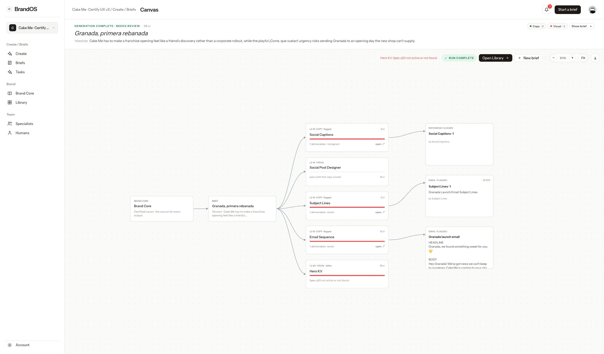
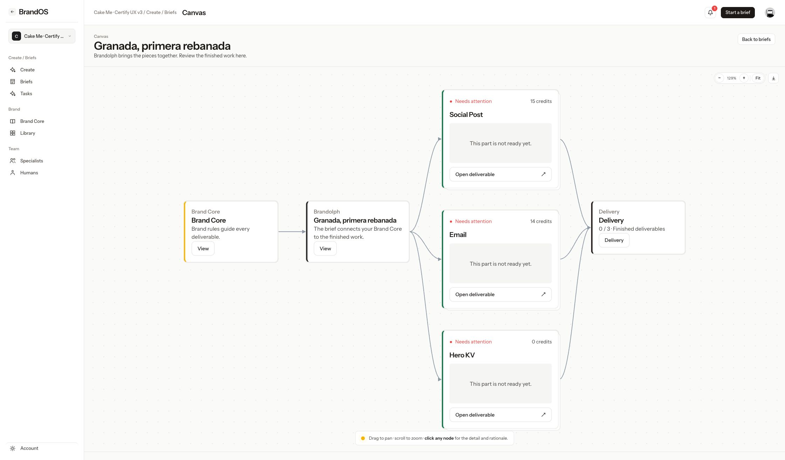
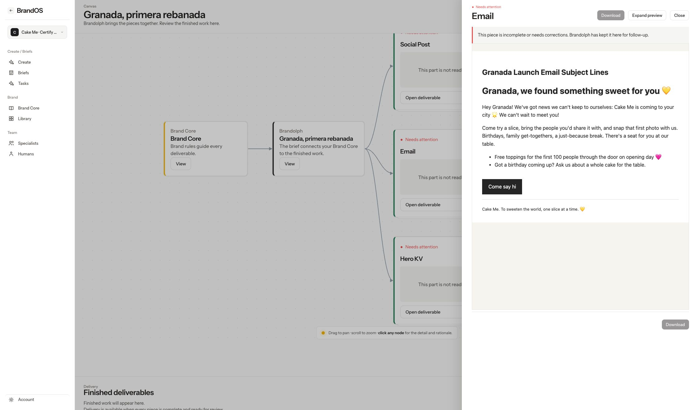

# Grouped deliverables on the existing Canvas

Branch: `feat/grouped-deliverables`, based on `origin/dev` at `296aa4962d0856fe68b18c62965f9e6722ee2372`.

Oscar selected the [research recommendation](../../research/2026-10-17-grouped-outputs.md). The existing Canvas engine still supplies dragging, pan, zoom, connectors, fit, and layout export. Only its terminal output nodes change: Social Post combines caption and design, Email combines subject/body and its selected HTML build, and Hero KV remains one output. Landing pages and decks use the same shared presentation mapping without changing the roster or prompts.

## Behavior

- Brand Core → Brief → grouped output nodes → Delivery remains a connected graph. Polling preserves node identities and dragged positions; opening or expanding the side preview preserves pan and zoom.
- Cards show one name, combined status, aggregate credits, and a preview. Streamed production fragments stay out of customer previews.
- One preview assembles the post or renders the email. Its primary Approve/Download action appears at both ends. Missing media is explicit, and successful complementary content remains available when another part fails.
- A blocked required piece wins over unrelated running work. All required content and checks must be complete before review; client workflow approval is required for Delivered. Automated QA and internal approval alone never imply client delivery.
- Delivery lists ready pieces, with one ZIP download for the complete set and one authenticated brief link. Recipients must sign in and have access to that workspace; this is not a public capability link.
- Approval reuses the existing output workflow and separation of duty. Interrupted multi-output approval can resume. When several deliverables share one underlying output review record, individual approval is disabled and the API rejects it; they must be reviewed together through the existing review desk, preventing one slot from silently approving its siblings.

## Role acceptance criteria

1. Only platform creative directors, platform admins, and super admins may expand **How it was made**. Workspace users, workspace admins, workspace actors with a reviewer persona, and platform designers receive no production DTO fields.
2. Customer cards/previews contain no agent codes, model metadata, tokens, per-agent costs, or queue lines. The raw `/api/runs/:id` endpoint rejects those actors before looking up outputs; specialist authoring/directory routes cannot serve them the production UI.
3. Workspace authorization applies to every grouped read, approval, and download. Missing authentication and foreign-workspace requests fail closed.
4. Approval requires the existing human workflow permission and review stage. A CD cannot internally approve their own submission. A client can approve only at client review.
5. The existing Certify route gate remains unchanged: end users cannot enter Certify by URL and use Brand Book V2 instead. The full test suite includes its role-routing regressions.
6. Brandolph remains the assistant name. New controls and all four combined states have matching en/es/ar keys, with RTL preview support.
7. AGENCY_OFFICE stays off; no roster, prompt, schema, or production migration changes are included.

## Local acceptance

The saved Cake Me brief `774a10f0-bcd3-4b5e-8718-4612baf35ce8`, **Granada, primera rebanada**, displays exactly three grouped output cards and seven graph connectors. Its existing outputs are incomplete or flagged, so all three honestly show Needs attention; no generated assets or approvals were fabricated and no paid generation was started.

As Oscar previously authorized, only this brief's existing `payload.deliveryPlan` was repaired in the local Docker Supabase database, `supabase_db_CaastorOS`, to preserve the original Social Post / Email / Hero KV plan when reopening. Its prior payload is backed up under the ignored `.mvp-local/grouped-deliverables/` folder. This is local test metadata, not a schema migration or production operation.

Browser checks: three cards and no agent cards; rendered Email subject and body in one panel; no production details for the current customer view; Expand/Return/Close; identical Canvas transform before and after closing; zoom control still works. Before/after images are below. The before image is the earlier capture of the original agent-node layout, not a fresh production capture.

Validation: `npm test` — **1,025 passed, 0 failed, 0 skipped**; independent server suite — **779 passed, 0 failed, 0 skipped**; `npm run build` — passed, with the existing large-chunk advisory. Server tests are included within the full suite as well, so these counts are not additive.

## Excluded files

Only feature source, tests, the selected research documentation, and small reference/acceptance screenshots belong to this change. Excluded: `artifacts/`, `inputs/`, `outputs/`, `.mvp-local/`, `.env*`, generated `dist/`, and unrelated pre-existing handoff folders/docs. Also excluded: `scripts/star-office-boutique.html`, `scripts/star-office-demo.mjs`, `docs/star-office-reference-demo.md`, and `docs/google-cloud-deployment-plan.md`. No large binary assets or font changes are needed.

## Before

## After

## Combined Email preview

