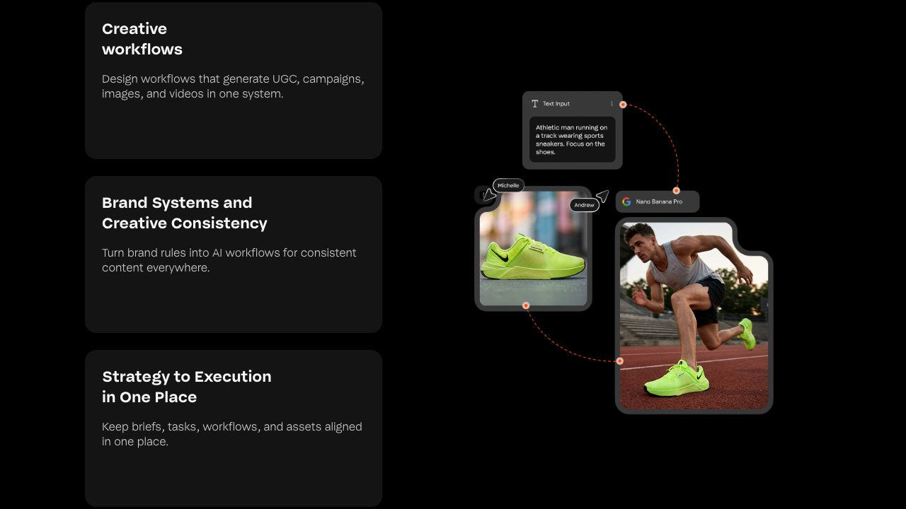
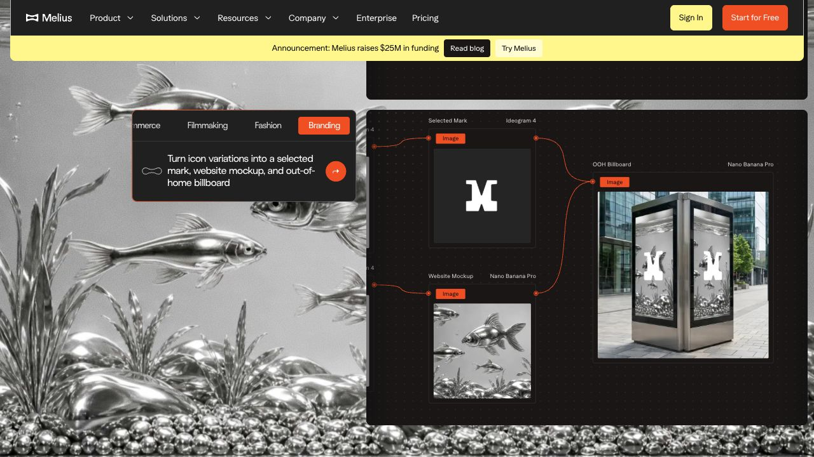
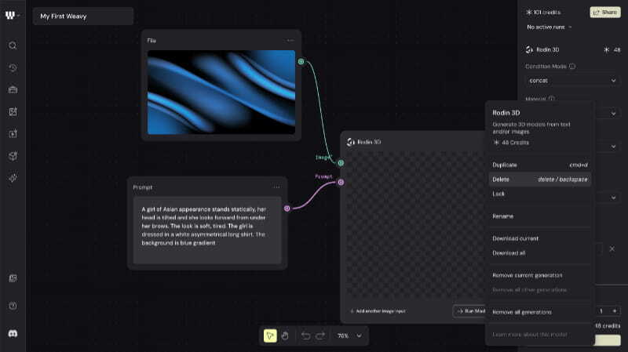
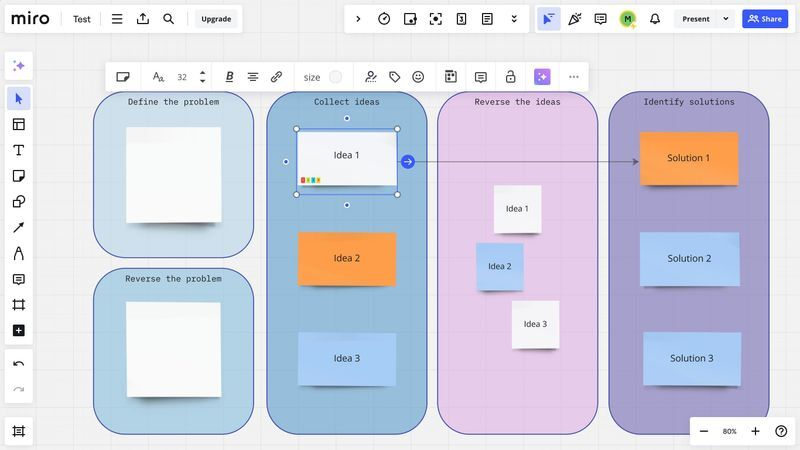
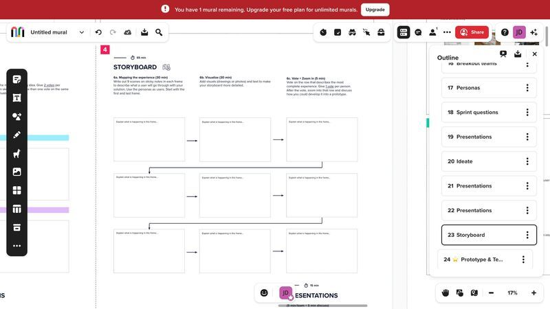
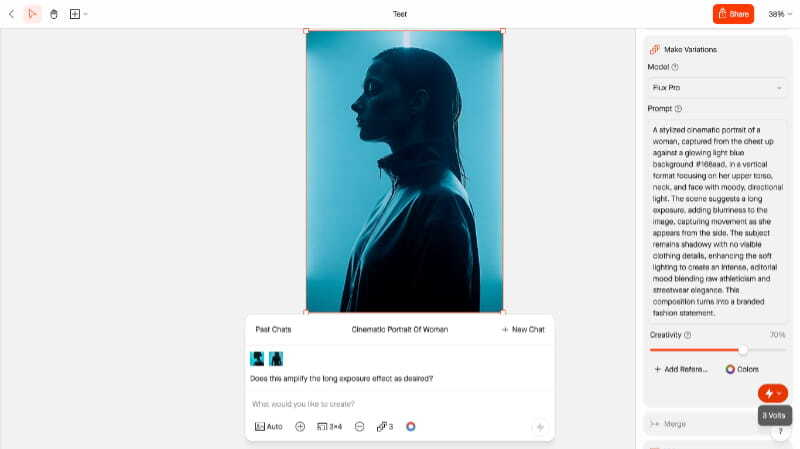
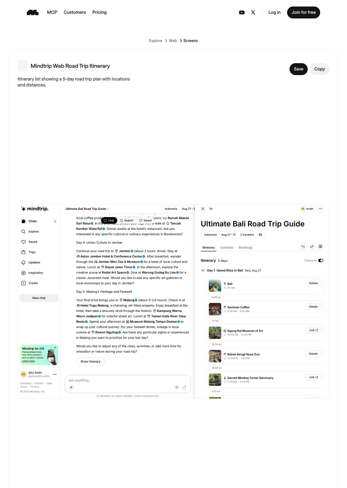

# Grouped outputs on the existing BrandOS Canvas

Research date: 17 October 2026. Decision owner: Oscar. Status: recommendation awaiting selection; research only.

## Recommendation

Keep **Brand Core → Brief → outputs** on the current node Canvas. Make each output **one compact deliverable node**, with a small stacked-edge cue and a thumbnail of the assembled result. Clicking it opens one combined preview in a side panel; the underlying Canvas and its position remain visible. The Granada brief should therefore have exactly **Social Post, Email, and Hero KV** as its three output cards.

This gives the customer a recognizable thing to review while retaining the relationships that make the Canvas useful. Use containers as an internal organizing idea, then summarize their result in one customer-facing node. Permanent expanded frames would leave the current agent-card clutter in place; a separate board per deliverable would make the customer leave the brief's shared context.

This is a proposed BrandOS interaction, synthesized from the references below. None of the inspected products proves the complete caption + design + QA customer-review pattern by itself.

## Scope and evidence

The brief is to decide the appearance and behavior of grouped outputs on the existing web Canvas. Its structure, pan/zoom, connectors, Brand Core, Brief, visual language, and assistant name **Brandolph** stay as they are. Agent rosters, prompts, database design, production migrations, and AGENCY_OFFICE are outside this research.

Refero style discovery was followed by searches for workflow canvases, node groups, frames, and generated-image detail screens. Existing BrandOS styling remains the visual reference; the research supplies interaction patterns, not a new palette. Refero supplied four inspected product captures. Mobbin's public catalogue and individual screen pages were inspected without signing up; its full authenticated flow library was not available. Mavity and Melius were examined through public demonstrations and official documentation, not through private production workspaces.

**Evidence labels:** **S** = visible in an inspected screenshot; **D** = described in official documentation; **P** = proposed BrandOS behavior. A static screenshot cannot establish transitions, aggregate status rules, or recovery behavior. “Not established” below means the inspected evidence does not answer the question.

The seven selections are complementary: two official creative-canvas demonstrations, three canvas organization captures, one selected-output inspector, and one adjacent AI-generated composite-result screen. They are not seven independently verified implementations of semantic deliverable grouping.

## Seven selected screens

All local images are reference captures, not proposed BrandOS UI or implementation screenshots. Official marketing illustrations are identified as such. Refero captures are stored at the resolution returned by its image tool.

| # | Screen and source link | What the screen contributes | What it does not establish |
| --- | --- | --- | --- |
| 1 | [Mavity — Creative workflows](https://www.mavity.co/) · [capture](2026-10-17-grouped-outputs/01-mavity-workflows.jpg) | S: text and reference image connect to a generated image. A useful distinction between inputs and the result. Public marketing illustration. | The illustration does not show a collapsed group, combined review state, or caption/image package. |
| 2 | [Melius — Branding showcase](https://www.melius.com/) · [capture](2026-10-17-grouped-outputs/02-melius-branding.jpg) | S: Selected Mark and Website Mockup connect to an OOH Billboard. Strong evidence for keeping provenance in the graph while recognizing finished outputs by name and preview. Public marketing demonstration. | No customer approval flow or group status is visible. Model labels belong to its creator interface, not our customer cards. |
| 3 | [Weavy — connected inputs and selected output](https://refero.design/pages/0cb89ff7-7891-4ab8-a8f4-4d311fe7af14) · [capture](2026-10-17-grouped-outputs/03-weavy.jpg) | S: file and prompt feed one output node; selection reveals controls and a menu with current/all downloads. Closest graph reference for multiple contributors leading to one output. | Inputs are not a collapsed deliverable group; the screenshot does not demonstrate a finished output or error recovery. |
| 4 | [Miro — related items inside named zones](https://refero.design/pages/e48b97a6-60a0-4d2c-99b9-d780071b3f8b) · [capture](2026-10-17-grouped-outputs/04-miro.jpg) | S: named colored containers organize several notes while connectors cross between zones. Best comparison for an expanded frame approach. | This is a brainstorming board, not AI generation or a delivered artifact. Containers retain all child clutter. |
| 5 | [Mural — storyboard area with outline](https://refero.design/pages/418ae17e-8069-4cd2-b3b4-f9da1534a9bb) · [capture](2026-10-17-grouped-outputs/05-mural.jpg) | S: a storyboard contains several connected panels; the outline identifies the larger unit. Useful comparison for a board/area per deliverable. | An outline item is not proof of a composite download or automatic aggregate status. |
| 6 | [Visual Electric — selected image and variations inspector](https://refero.design/pages/2521354a-0aaa-4cce-9830-e39d554ecf28) · [capture](2026-10-17-grouped-outputs/06-visual-electric.jpg) | S: the result remains central while a side inspector holds generation controls. Strongest detail-view reference for progressive disclosure without changing the canvas. | It shows one selected image and variation controls, not an assembled post or email. |
| 7 | [Mobbin: Mindtrip — Road Trip Itinerary](https://mobbin.com/explore/screens/a9441006-361d-427f-8326-740d91b7352f) · [capture](2026-10-17-grouped-outputs/07-mobbin-mindtrip.jpg) | S: one named itinerary groups days and nested place cards with images, text, and details in a result pane beside the conversation. Useful adjacent AI result-composition reference. | It is not a node canvas or advertising generator. The capture shows the opened pane; its opening transition and generation recovery were not exercised. |

Additional checks deliberately excluded from the shortlist: [Mobbin's FLORA blank canvas](https://mobbin.com/explore/screens/d053f37a-13a4-4f0b-b1e3-0b3115d21f2c) establishes a canvas shell but contains no grouped outputs; [Krea's homepage](https://mobbin.com/explore/screens/d9c38f72-76f1-4b4c-8e58-45cc9fee5cd0) establishes discovery cards, not the grouping behavior in question. Neither is evidence for a finished composite deliverable.

## Mavity: what actually groups

Mavity distinguishes a **Flow**, its **node groups**, and generated **assets**. Its Canvas documentation describes selecting related nodes, grouping, moving and duplicating them together, and previewing the total selected credit cost. Outputs remain on their generating nodes and are also available as assets. This supports organizing a production pipeline; it does not establish a single reviewable post containing both caption and image. [Official Canvas documentation](https://mavity.featurebase.app/help/articles/8043410-working-on-the-canvas).

Grouped sections can run together, but nodes execute independently. Regeneration may replace the previous output unless saved manually. Public Flow sharing lets someone copy the workflow, so it should not be treated as a model for a customer delivery link. The inspected material does not specify a group's aggregate progress badge or its partial-failure appearance. [Running and managing Flows](https://mavity.featurebase.app/help/articles/2735248-running-and-managing-flows).

The homepage also presents **Takes** as an asset holding versions. Versions of one asset are a different relationship from the complementary caption, design, and QA needed to finish one Social Post. Keep those two concepts separate in BrandOS. [Mavity product page](https://www.mavity.co/).

## Melius: containers, versions, and packaged workflows

Melius documents group nodes as containers for related nodes. Generative nodes retain versions, including generating thumbnails. Multi-selection downloads can collect current outputs, including contents of selected groups, into a ZIP; nodes without outputs are omitted. These are useful organization and export patterns, but a ZIP of available files does not establish that a deliverable is complete. [Nodes documentation](https://docs.melius.com/canvas/nodes).

Its templates/presets package repeatable workflows behind an input form and result view. Documentation describes a credit preview, run history, and readiness notifications. It also describes a failed template run showing a reason and credit/refund information, retaining form inputs, and deleting that run's canvas and earlier intermediate outputs. This is specific to that template-run surface; it should not be generalized to ordinary canvas groups. The older project-template advice and newer group-to-template documentation describe different scopes, so this report does not assume universal template behavior. [Repeatable workflows](https://docs.melius.com/help-center/marketers/repeatable-workflows).

For an ordinary blocked image/video generation, Melius documents failure on the affected node and rerunning from there. This is the useful recovery principle for BrandOS: identify the affected part without discarding the whole brief. Its exact customer-facing aggregate state still needs our own definition. [Troubleshooting](https://docs.melius.com/help-center/marketers/troubleshooting).

## Behavior comparison

The screenshot IDs below refer to the linked selections above. Documented behavior supplements the screenshots only where marked D. Pros and cons are design judgments for BrandOS, not vendor claims.

| Reference | Grouping on Canvas | Opening one deliverable | Status / progress | When one piece fails | Pros for BrandOS | Cons for BrandOS |
| --- | --- | --- | --- | --- | --- | --- |
| Mavity (#1 + docs) | S/D: connected nodes; selected groups organize the pipeline. | D: generated output on its node, with downloads and Assets access. Composite viewer not established. | D: selected total credit preview; combined completion badge not established. | D: independent execution; aggregate failure treatment not established. | Preserves graph context; shows why total group cost matters. | Customer still has to interpret production nodes; workflow sharing exposes a different object from a delivered result. |
| Melius (#2 + docs) | S: named outputs connected by dependencies. D: group containers and packaged templates. | D: image fullscreen; template inputs/result/history; multi-output review exists for resize results. | D: generating versions and template run history/notifications. Universal group progress not established. | D: ordinary failures on node; template failures have distinct cleanup behavior described above. | Closest documented packaging precedent; separates versions from graph structure. | Model-heavy creator UI; skipping missing outputs in export would hide incompleteness if copied blindly. |
| Weavy (#3) | S: multiple inputs feed one selected output node. | S: selected-node controls beside the graph; download current/all menu. Opening transition not exercised. | S: run controls and no active run; group progress not established. | Not established. | Strong fit for keeping provenance around one output; controls can be secondary. | Production language and technical controls would overwhelm customers. |
| Miro (#4) | S: permanent named containers with child notes and cross-container connections. | No finished-deliverable viewer shown. | No generation or aggregate progress shown. | Not established; no generation in this capture. | Immediate containment; relationships remain visible. | Enlarges the graph and keeps every contributing piece visible; weaker than one finished card. |
| Mural (#5) | S: storyboard area with connected panels and a matching outline entry. | S: focused area and outline selection; no finished-artifact viewer shown. | Outline position is navigation, not production status. | Not established. | Useful for long, internally structured outputs such as decks. | A board per deliverable adds navigation and overstates a two-part Social Post. |
| Visual Electric (#6) | S: selected output on canvas with side inspector. | S: large result and secondary controls together; transition not exercised. | No combined generation progress shown. | Not established. | Best detail-view hierarchy: result first, controls to the side. | Variations are alternatives, not mandatory complementary pieces; must not copy the wrong relationship. |
| Mindtrip / Mobbin (#7) | S: no canvas; one itinerary contains nested days and image/text place cards. | S: one named result pane beside its source conversation. | Structural day count, not generation completion. | Not established. | Makes a multi-part result understandable as one object; nested detail stays secondary. | Adjacent-domain reference only; replacing Canvas with its list would violate this brief. |

## Proposed BrandOS appearance and behavior

Everything in this section is **P**, offered for Oscar's choice, not a description of current implementation.

### One terminal node per deliverable

Each node keeps the existing Canvas card treatment and connector from Brief. Show the deliverable name, an assembled preview thumbnail, one combined status, and one total credit figure. A subtle second edge may signal multiple contributing pieces without adding separate child nodes. Avoid a numeric stack badge that could be mistaken for the number of finished posts.

| Visible card | Pieces that contribute to it | Customer preview |
| --- | --- | --- |
| Social Post | Social Captions + Social Post Designer; QA is a completion gate | One image with its caption and hashtags together |
| Email | Subject Lines + Email Sequence; include HTML build when required for that email | Chosen subject, preheader when present, and rendered email body as one piece |
| Hero KV | Hero KV output; QA is a completion gate | One large key visual |

QA and HTML build describe requirements, not new agents or proposed prompt changes. Existing run data supplies contributions; an expected piece must remain visible as missing even if no run was saved. A completely missing output must not disappear from the planned deliverables. The report does not propose a DB repair or schema change.

### Open the result, keep the Canvas

Selecting a node opens a roomy side panel over the Canvas, retaining the current pan/zoom and selected node. Closing or pressing Escape returns to the same place. Expand the preview to fullscreen when the email or image needs more space, then return to the same panel.

The default view is the combined finished piece, with **Approve** when reviewable or **Download** when delivered, repeated above and below a long preview. A missing image is an explicit placeholder, never a blank successful-looking post. Do not make customers open a caption node and then a design node to reconstruct the result.

CDs and admins may expand a collapsed **How it was made** section to inspect contributors and recovery controls. End users receive the combined result without agent codes, model labels, tokens, prompts, or per-agent costs. The permission boundary must apply to direct per-agent URLs as well as visible controls. This is a proposed acceptance criterion, not a verified security result from this research.

### Combined state and partial failure

| Combined state | Required meaning | Customer message / action |
| --- | --- | --- |
| Working | Required pieces or checks are still queued/running; no blocking failure is known. | “Preparing your post” or “2 of 3 parts complete” if the denominator is reliable; no agent queue or streaming text. |
| Needs attention | A required piece failed, is missing after work stopped, or did not pass its required check. | “The image needs another attempt”; preserve available preview content, keep approval disabled. |
| Ready for review | Every required piece exists in a usable form and required checks pass for the current assembled version. | Approve the whole deliverable. Generated text alone is insufficient. |
| Delivered | The complete current version has been approved/released. | Download that version. A later retry must not silently change an approved package. |

For a current candidate version, blocking failure takes precedence over unrelated work still running; “Working” must not hide it. Successful parts stay available. A CD/admin retries the failed piece, then reruns dependent assembly/checks as needed; completed unrelated pieces stay intact. Aggregate credits come from recorded charges once each, with estimates distinguished from actual totals and refunds reflected only when recorded. These rules require validation if Oscar selects this approach.

## Cake Me sketch: Granada, primera rebanada

Illustrative layout and states only; this is not a capture of live brief status, generated Cake Me artwork, or a proposed implementation. Credit letters are placeholders for actual totals. There are exactly three output cards.

```text
Existing node Canvas — same pan, zoom, connectors, and card styling

                                         ┌─────────────────────────────┐
                                    ┌───▶│ Social Post                 │
                                    │    │ [image + caption thumbnail] │
                                    │    │ Ready for review · S credits│
                                    │    └─────────────────────────────┘
 ┌────────────┐     ┌───────────────┐│
 │ Brand Core │────▶│ Brief         ││    ┌─────────────────────────────┐
 │ Cake Me    │     │ Granada,      │├───▶│ Email                       │
 └────────────┘     │ primera       ││    │ [rendered email thumbnail]  │
                    │ rebanada      ││    │ Working · E credits         │
                    └───────────────┘│    └─────────────────────────────┘
                                    │
                                    │    ┌─────────────────────────────┐
                                    └───▶│ Hero KV                     │
                                         │ [visual / missing preview]  │
                                         │ Needs attention · H credits │
                                         └─────────────────────────────┘

Brandolph stays in its existing assistant position.
```

Opening Social Post:

```text
Canvas remains behind the panel     SOCIAL POST                 Close
                                   Ready for review          [Approve]
                                   ┌─────────────────────────────────┐
                                   │ Finished Cake Me post image      │
                                   └─────────────────────────────────┘
                                   Finished caption + hashtags
                                   S credits total
                                   [Approve]

                                   ▸ How it was made  (CD/admin only)
```

The image and caption above are content slots, not invented deliverables. If either fails, the panel clearly identifies the missing part and does not offer approval. The three output nodes remain on the Canvas throughout.

## Decision rationale and boundary

**Choose the compact composite node plus combined preview panel.** Weavy supports the many-inputs-to-one-output graph idea; Visual Electric supports a focused result with secondary controls; Mindtrip illustrates one understandable result containing several complementary pieces. Mavity and Melius show why workflow groups and version history are useful internally, while also exposing the limits of simply wrapping nodes or downloading whatever files happen to exist.

The tradeoff is that the assembled thumbnail and completeness rules need explicit product definitions. That is preferable to asking customers to understand agents, or expanding containers until the brief becomes unreadable. Permanent frames, expanded stacks of agent cards, and separate boards were considered and are not the recommended direction.

No application code, branch, or DB data was changed during this research. Pre-existing uncommitted implementation work was left intact. Only this report and its matching screenshot folder were created; no build, commit, push, PR, or migration was performed. Implementation awaits Oscar's selection.

## Reference images

### 1. Mavity — public creative-workflow illustration



### 2. Melius — public Branding canvas demonstration



### 3. Weavy — Refero product capture



### 4. Miro — Refero product capture



### 5. Mural — Refero product capture



### 6. Visual Electric — Refero product capture



### 7. Mindtrip — public Mobbin screen page


