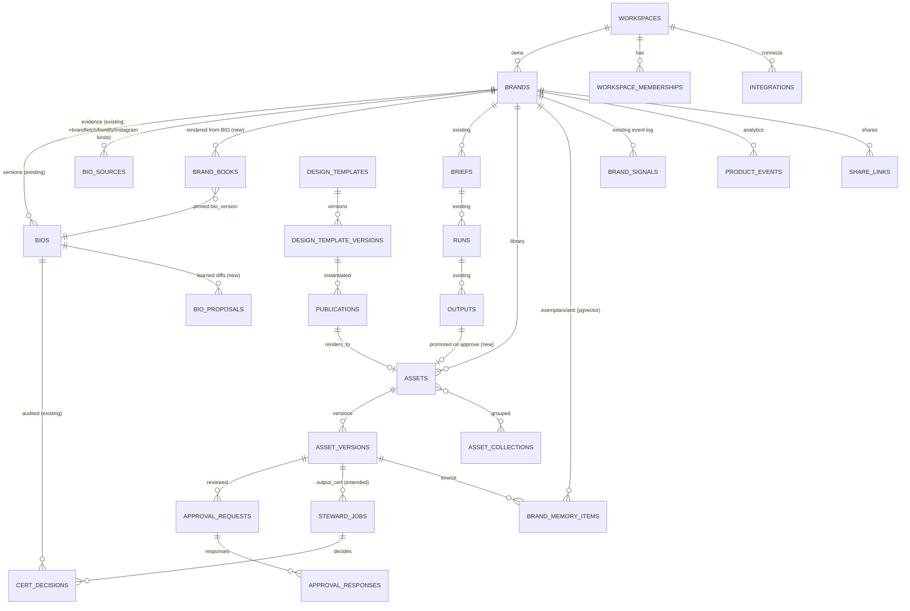

# BrandOS — "Frontify for SMBs" Build Spec
*Draft v0.1 · 2026-10-10 · CTO · Read-only review of `CaastorOS` @ main (6fafe38) + uncommitted tree*

> **Thesis.** Frontify is a *manual* system of record: humans write guidelines, upload assets, build templates, and approve. BrandOS reproduces the same flows for SMBs but **generates** each artefact from the certified BIO, and puts a **human certification stamp** on what matters. Same mental model the market already understands; ~10% of the setup work; a fraction of the price.
>
> **Clean-room rule.** This spec describes Frontify's *publicly documented flows and logic* only (help center, product pages, reviews). No Frontify code, UI assets, block designs, or copy are to be reused. Name things in our own vocabulary.

Legend — Effort: **S** ≤3 dev-days · **M** 1–2 weeks · **L** 3+ weeks. Priority: **P0** (VDS demo / MVP-critical), **P1** (November MVP), **P2** (Q1).

---

## 0. Current BrandOS baseline (what exists today)

| Area | Existing code / tables |
|---|---|
| Discovery → BIO | `server/src/inngest/functions/compile-bio.js` (Firecrawl ≤6 pages, text uploads, Gemini 2.5 Pro synthesis, Gemini Flash vision for `visual{}`), `routes/discovery.js`, `routes/discovery-session.js`, `routes/discovery-delegation.js`, `src/portal-discovery.jsx` |
| BIO model | `bios` (append-only `version`, `payload jsonb`, `score`, `certified`, `self_certified`, `cert_valid_until`), `bio_sources`, `server/src/lib/bio-schema.js` (`BIO_FIELDS`, `normalizeBio`, `getBioForAgent`, `projectBio`), `bio-hash.js`, `bio-diff.js` |
| Certification | `steward_jobs`, `cert_rubric_versions`, `cert_decisions`, `bio_attestations`; `routes/steward.js`, `lib/evaluate-certification.js`, `lib/self-certify.js`, `lib/assign-steward.js`, `portal-team.jsx` RubricPanel |
| Production | `briefs`, `runs`, `outputs` (`status ∈ pending/approved/flagged/rejected`, `asset_url`), `qa_results`; `routes/runs.js`, `routes/outputs.js` (`PATCH /:id`, `POST /:id/workflow`), `routes/craft.js` (human polish queue) |
| Memory | `brand_signals`, `brand_specialist_stats`, `lib/brandolph-memory.js` (`recordSignal`, `loadBrandMemorySummary` → crew assembly only). **No embeddings, no asset library, no edit→BIO loop.** |
| "Templates" | `templates` / `template_versions` = **brief/assembly recipes** (crew + brief skeleton), *not* design templates. Keep; new design-template concept needs a distinct name. |
| Uploads | `uploads` (url, mime, `bucket_hint`), Supabase Storage bucket `bio-sources` |
| Roles | `lib/permissions.js`: platform `super_admin, platform_admin, creative_director, designer`; workspace `workspace_admin, user`; `workspace_memberships`, `role_permissions`, `access_invitations`, `authorization_audit_events` |
| Analytics | `api_usage_events`, `ledger` (cost/credits) — no product-usage analytics |
| Integrations | None outbound. Inbound: Firecrawl, OpenRouter, Anthropic, fal.ai |

---

## 1. Brand Portal & Guidelines (block-based brand book)

### 1.1 How Frontify does it
1. Admin creates a **Brand** → one or more **Guidelines** (a portal site, themeable, can be public/password/SSO).
2. Guideline = tree of **Pages** (sections) → each page is a stack of **Content Blocks**.
3. Editor enters *Edit Mode* → clicks **+** → picks a block → fills it by hand. Documented block types include: Text, Image/Asset, **Color Scale** (prioritised colors, accents/contrast), **Color Swatch** (downloads as ASE/LESS/SCSS), **Fonts** (own or Adobe fonts), **Typo Styles** (font+size+line-height+text/bg color combos), **Font Kit** (zip download), Icon Library, **Template** block, Code Sandbox / Snippet / Attributes / Developer Kit / Storybook, **Do & Don't** (written or visual, side-by-side), plus custom blocks via Brand SDK.
4. Changes publish live; every update is tracked; theme (heading styles etc.) cascades into blocks.
5. Viewers browse/search; Brand Assistant can be switched on per guideline.

**Data model (inferred from docs/API):** `Brand → Guideline → Page → Block{type, settings, content}`; "brand essentials" (color palettes, font families) are first-class objects reused by blocks and templates (templates derive colors from the guideline's color blocks).

Sources: https://help.frontify.com/en/articles/133908-how-to-add-content-blocks · https://help.frontify.com/en/articles/2388957-do-and-don-t-block · https://www.frontify.com/en/brand-guidelines

### 1.2 BrandOS SMB version — "Brand Book, auto-written"
- **Auto-generate** a full brand book from the certified BIO: a fixed, opinionated page tree (Essence · Positioning · Audience · Voice · Messaging · Color · Type · Logo · Imagery · Do & Don't · Channels). No blank-canvas editor.
- **Blocks are views over BIO fields**, not free content: e.g. `color_palette` block renders `bio.visual.palette[]` with roles + WCAG pairs; `voice_rules` renders `voice.register/forbidden/signatures`; `do_dont` renders `strategic.notList`, `voice.forbidden`, `visual.avoid` paired with *generated* good/bad examples from the specialists.
- **Exports:** CSS variables / JSON tokens / ASE swatches, PDF brand book, public share link.
- **Simplify:** no custom themes, no page builder, no code blocks; 8–10 block types max. Editing a block = editing the underlying BIO field (creates a new BIO version → steward re-cert on material change).
- **Certification adds:** every page shows "Certified by {steward} · BIO v{n} · {date}" and per-field provenance chips (source + confidence, from `payload.confidence`). Uncertified fields render as "Inferred — pending review." Frontify has no equivalent.

### 1.3 Where it lands
- **Existing:** `bio-schema.js` (`BIO_FIELDS` registry is the block catalog source), `routes/bios.js` (GET/PATCH), `portal-discovery.jsx` BioViewer, `bio-focus.js`, `load-brand-bio.js`.
- **New:** table `brand_books(id, brand_id, bio_version, layout jsonb, published bool, share_token, theme jsonb, created_at)`; `lib/brand-book.js` (pure `bioToBlocks(bio) → Page[]`); routes `GET /api/brand-book/:brandId`, `POST /:brandId/publish`, `GET /public/brand-book/:token`, `GET /:brandId/export?format=css|json|ase|pdf`; SPA `src/portal-brandbook.jsx` + hash route `#/brand-book`.
- **BIO gaps to close first:** visual essentials are thin (palette has hex+name only; no roles, contrast pairs, logo variants, type styles). Extend `BIO_FIELDS` (`visual.palette[].role`, `visual.contrastPairs[]`, `visual.typeStyles[]`, `visual.logos[]`) — feed from Brandfetch API and/or the vision pass.

**Effort:** M (renderer + export) + S (BIO visual extension) · **Priority:** P0 (read-only view for VDS), P1 (publish/share/export).

---

## 2. DAM — asset library with versioning, metadata, rights

### 2.1 How Frontify does it
1. Assets live in **Libraries** (media, logos, icons, documents) → folders/collections.
2. Upload → auto-thumbnail; **AI auto-tagging**; editors fill **custom metadata fields** (controlled vocabularies: brand, market, asset type, campaign, language, usage rights).
3. **Rights:** license type, regions, channels, releases, **expiry date** → alerts before expiry, auto-restrict/archive after.
4. **Versioning:** each re-upload = new version, full history kept; users see **latest approved** by default.
5. Distribution: download (with format/size conversion via media processing), share links, plugins (Figma, Adobe, Canva), API/webhooks.
6. Analytics on views/downloads; MAU-based usage.

**Data model:** `Library → Folder/Collection → Asset{versions[], metadata{field→value}, tags[], rights{license, regions, channels, expires_at}, status, permissions}`.

Sources: https://www.frontify.com/en/guide/digital-asset-management-version-control · https://www.frontify.com/en/guide/digital-asset-management-best-practices · https://www.frontify.com/en/guide/digital-rights-management · https://www.rfp.wiki/design-multimedia/digital-asset-management-platforms/frontify

### 2.2 BrandOS SMB version — "Library, self-filling"
- **Auto-populated** from three sources: (a) Discovery (scraped logos/images, uploads — today images are *skipped* in `compile-bio.js`), (b) Brandfetch (logos light/dark, SVG), (c) **every approved specialist output** lands in the library automatically.
- **Metadata auto-filled**, not typed: specialist, deliverable kind, platform/size, campaign = brief, BIO version, locale, model-free provenance, QA scores (`qa_results`), AI tags from vision QA.
- **Rights simplified** to 3 fields: `origin` (client-owned / generated / stock / licensed), `license_note`, `expires_at` → nightly Inngest sweep flags/archives.
- **Versioning:** re-runs/edits of an output create a new `asset_version`; "current" = latest **certified** version.
- **Certification adds:** a "BrandOS Certified" status per asset (steward-reviewed against the BIO) distinct from "approved by client". Library filter: *Certified only*.

### 2.3 Where it lands
- **Existing:** `outputs` (has `asset_url`, `status`), `uploads`, `bio_sources`, Storage buckets, `routes/outputs.js`, `routes/runs.js` (fal → Storage persist path), `qa-vision.js`, `OutputCard` in `portal-shared.jsx`.
- **New tables:** `assets(id, brand_id, kind, title, origin, source_output_id, source_upload_id, current_version_id, status ∈ draft/approved/certified/archived, rights jsonb, expires_at, tags text[], metadata jsonb, created_at)`, `asset_versions(id, asset_id, version, storage_path, mime, width, height, bio_version, created_by, payload_hash, created_at)`, `asset_collections(id, brand_id, name)`, `asset_collection_items`.
- **Optional (P1):** `asset_embeddings(asset_id, embedding vector(…))` via pgvector for semantic search + memory (§5).
- **New routes:** `routes/assets.js` — `GET /api/assets?brandId&filter`, `POST /api/assets` (upload), `POST /:id/versions`, `PATCH /:id` (metadata/rights), `GET /:id/download?size=`.
- **New Inngest fns:** `promote-output-to-asset` (on output approve), `asset-autotag` (vision), `rights-expiry-sweep` (cron).
- **SPA:** `src/portal-library.jsx` (route `library` already exists in nav per IMPLEMENTATION_LOG QW-001 "BIO / Library").

**Effort:** L · **Priority:** P1 (promote-on-approve + basic library), P2 (rights sweep, collections, embeddings search).

---

## 3. Templates with locked fields

### 3.1 How Frontify does it
1. Designer builds a design in InDesign/Sketch/Figma → uploads to **Template Library** (status *Not Published*).
2. **All layers locked by default.** In Edit Mode, designer clicks an element → unlocks text, style, color, position, visibility. Color choices restricted to the guideline's color blocks.
3. **Publish** with name, description, category. Later edits → status *Unpublished Changes* → publish/discard/unpublish. *Replace* swaps the source file while preserving element IDs.
4. End user creates a **Publication** from a template → edits only unlocked fields → exports (PDF/PNG/print). Publications stay linked to the template.

**Data model:** `Template{source_file, status, category, elements[{id, lockedProps, allowedColors}]} → Publication{template_id, overrides{element_id→value}}`.

Sources: https://help.frontify.com/en/articles/5682743-setting-up-templates · https://help.frontify.com/en/articles/14289228-managing-template-updates-and-rollout-to-end-users · https://help.frontify.com/en/articles/3597599-template-library

### 3.2 BrandOS SMB version — "Smart templates"
- **Generated, not designed:** the Visual + Web specialists produce a starter set per brand (IG post, story, LinkedIn banner, flyer A5, email header, price card) using BIO palette/type/logo. Templates are **HTML/SVG + JSON schema** (render with Satori/resvg or headless Chromium → PNG/PDF).
- **Locks = BIO rules:** colors limited to `visual.palette`, fonts to `visual.type`, logo position/clear-space fixed; editable slots are declared in the schema (`headline`, `body`, `image`, `cta`). Copy slots can be **filled by a specialist** (Headlines / Social Captions) on request.
- **Publication** = filled template; on export it runs **voice QA + vision QA**; passing → "Certified-ready", optional one-click send to steward for certification.
- **Naming:** call these `design_templates` to avoid clash with existing `templates` (brief recipes).

### 3.3 Where it lands
- **Existing:** `compose-image-prompt.js`, `deliverables.js` (`falSizeForPlatform`), `qa-voice.js`, `qa-vision.js`, `template_versions` (pattern for versioning + status draft/live/archived to copy).
- **New tables:** `design_templates(id, brand_id NULL=global, slug, name, category, status ∈ draft/published/changed/archived, current_version)`, `design_template_versions(id, template_id, version, markup text, slots jsonb, locks jsonb, created_at)`, `publications(id, brand_id, template_version_id, values jsonb, asset_id, status, created_by)`.
- **New routes:** `routes/design-templates.js` (`GET`, `POST /generate` from BIO, `POST /:id/publish`), `routes/publications.js` (`POST`, `PATCH /:id`, `POST /:id/render`, `POST /:id/certify`).
- **New lib:** `lib/render-template.js` (server render), `lib/template-locks.js` (pure validator: values ⊂ allowed palette/fonts).
- **SPA:** `src/portal-templates.jsx` (gallery + slot form + live preview).

**Effort:** L · **Priority:** P1 (3–4 generated templates + render), P2 (editor, custom upload).

---

## 4. Review & approval workflows

### 4.1 How Frontify does it
1. On an asset, requester opens **Request approval** → picks reviewers.
2. Sets **approval rule**: *No rejections* (all must respond, ≥1 approve) · *First responder decides* · *Majority* · *Unanimous*.
3. Sets **deadline** + **resolution if no response** (auto-approve or auto-reject), **status after approve/reject** (moves asset to a workflow column), **reset responses on revision upload**, **allow reviews until closing date**.
4. Reviewers comment/annotate, approve/reject; **approval history** per asset.
5. Workflow board (statuses/columns) per project; tasks; email notifications (reviewers complain of too many).

**Data model:** `ApprovalRequest{asset_id, reviewers[], rule, deadline, timeout_resolution, status_on_approve, status_on_reject, reset_on_revision} → Response{reviewer, decision, comment, at}`; `WorkflowStatus` columns.

Sources: https://help.frontify.com/en/articles/4111876-feedback-and-approval-process · https://www.frontify.com/en/solution/brand-governance

### 4.2 BrandOS SMB version — "Two-key approval: client + certified designer"
- **Default flow, no setup:** Output generated → auto-QA (voice + vision) → **Client approves** (any workspace member; rule fixed to *first responder* for SMB) → optional **Steward certification** (paid tier/credits) → asset becomes *Certified* in library.
- **Smart routing:** low QA score or BIO-conflict auto-routes to steward; high score + client approve can skip (configurable per plan).
- **Keep only 2 rules** for SMB: *Any one approver* and *All approvers*; deadline with auto-reminder (not auto-approve).
- **Reset on revision** always on (new `asset_version` invalidates prior approvals — reuse `payload_hash` binding).
- **Certification adds:** rubric-scored decision + immutable audit row (reuse `cert_decisions` pattern), four-eyes rule, certified-by chip on the asset. Frontify approvals are opinions; ours are scored and auditable.
- **Every decision is a memory signal** (`recordSignal`) — approve/reject/edit feed §5.

### 4.3 Where it lands
- **Existing:** `outputs.status`, `routes/outputs.js` (`POST /:id/workflow` already exists — extend), `routes/steward.js` + `evaluate-certification.js` (rubric engine — generalise from BIO to output), `steward_jobs` (add `kind='output_cert'`), `notifications` + `notification_prefs`, `lib/notify.js`, `brand_signals`, `portal-team.jsx` (reviewer UI), `portal-craft.jsx` (craft queue).
- **New tables:** `approval_requests(id, brand_id, asset_version_id, rule ∈ any/all, deadline, status, created_by)`, `approval_responses(id, request_id, reviewer_id, decision, comment, at)`; `output_cert_rubric` row in `cert_rubric_versions` (scope column `bio|output`).
- **New routes:** `POST /api/approvals`, `POST /api/approvals/:id/respond`, `GET /api/approvals?brandId&mine=1`; `POST /api/steward/output-jobs` (reuse handler).
- **Notifications:** digest by default (fix the Frontify complaint).

**Effort:** M · **Priority:** P0 (client approve + certified chip already partially there — demo), P1 (approval requests + output certification).

---

## 5. Brand Assistant (and memory)

### 5.1 How Frontify does it
1. Admin enables Brand Assistant in account settings → activates it per guideline; customises name, welcome, disclaimer.
2. Users chat in the portal; it **retrieves (RAG) from text guideline content the user can access**, answers with **source references**, generates/reviews copy, finds assets.
3. 100+ languages, but uses the **default-language** guideline only; **text only** (no images/PDFs/video).
4. Same knowledge exposed to external AI via **MCP server** (packs: discovery, brand-portal, asset-creation, creative-automation, workflow-automation, …) and Claude/Copilot connectors.

Sources: https://help.frontify.com/en/articles/14718123-brand-assistant · https://mcp.frontify-integrations.com/ · https://help.frontify.com/en/articles/14787214-frontify-mcp

### 5.2 BrandOS SMB version — "Brandolph, who remembers"
- Brandolph already exists (`routes/brandolph.js`, `prompt.js`, floater). Add:
  - **Cited answers**: every claim cites BIO field path + provenance (`getBioForAgent` already carries inferred markers).
  - **"Is this on-brand?"** check: paste text/upload image → `qa-voice` / `qa-vision` against BIO → verdict + fixes (Typeface-style, Frontify's assistant doesn't score).
  - **Multimodal**: images and PDFs count (we already vision-QA).
  - **Learning memory** (the real differentiator):
    1. *Exemplar memory* — certified/approved assets embedded (pgvector) per brand × specialist; top-k injected as few-shot into `compose-specialist-prompt.js`.
    2. *Anti-exemplars* — rejected/flagged outputs + reason injected as "don't".
    3. *BIO proposals* — repeated client edits/steward fixes cluster into proposed BIO diffs ("drop 'artisanal'") → steward approves → new BIO version (`bio-diff.js` exists).
- **Expose BrandOS as an MCP server** (read: `get_brand_book`, `get_bio_slice`, `check_on_brand`, `search_assets`) so SMBs' ChatGPT/Claude use their certified brand.

### 5.3 Where it lands
- **Existing:** `routes/brandolph.js`, `prompt.js`, `lib/brandolph-memory.js`, `brand_signals`, `brand_specialist_stats`, `compose-specialist-prompt.js`, `qa-voice.js`, `qa-vision.js`, `bio-diff.js`, `steward-copilot.js`, `portal-floater.jsx`.
- **New:** migration enabling `pgvector`; tables `brand_memory_items(id, brand_id, specialist_id, kind ∈ exemplar/anti/rule, asset_version_id, text, reason, weight, embedding vector, created_at)`, `bio_proposals(id, brand_id, base_version, diff jsonb, evidence jsonb, status, decided_by)`; lib `memory-retrieve.js`; Inngest `memory-index` (on approve/reject), `bio-proposal-miner` (weekly); route `POST /api/brandolph/check` (on-brand check); `server/src/mcp/` (MCP server endpoint, read-only, API-key per workspace).

**Effort:** M (on-brand check + citations) · L (memory + proposals) · M (MCP server) · **Priority:** P0 on-brand check (demo), P1 exemplar memory, P2 BIO proposals + MCP.

---

## 6. Analytics

### 6.1 How Frontify does it
Dashboard on guideline page views, searches (incl. zero-result), asset views/downloads, template usage, by user group/region/date; MAU tracking (billing basis); Enterprise dashboard across brands. Used to spot unused/missing guidance.

Sources: https://www.frontify.com/en/brand-guidelines · https://help.frontify.com/en/articles/12399792-how-monthly-active-user-mau-pricing-works

### 6.2 BrandOS SMB version — "Brand health"
- One page, not a BI tool: **Brand Health score** = BIO score + cert freshness (`cert_valid_until`) + % outputs certified + on-brand check pass rate + asset rights at risk.
- **Usage:** assets downloaded, templates used, brand-book views, top Brandolph questions (= gaps in BIO → feeds `bio-focus.js` steward focus).
- **Agent quality:** per-specialist approve/flag rates — already in `brand_specialist_stats`.
- Monthly email digest to the owner.

### 6.3 Where it lands
- **Existing:** `brand_specialist_stats`, `brand_signals`, `api_usage_events`, `ledger`, `score-bio.js`, `src/lib/home-stats` (home stats test exists).
- **New:** `product_events(id, workspace_id, brand_id, user_id, event, object_type, object_id, props jsonb, at)` (append-only); `GET /api/analytics/brand-health/:brandId`; SPA section in home or `#/health`.

**Effort:** S–M · **Priority:** P1 (health score), P2 (usage dashboards, digest).

---

## 7. Integrations & plugins

### 7.1 How Frontify does it
- **GraphQL API** (assets+metadata, brands, libraries, guidelines beta, workflows; webhooks; media processing) — reportedly Enterprise-tier.
- **MCP server** with scoped packs (read-only discovery/brand-portal → write asset-creation/workflow).
- **Brand SDK** for custom blocks/apps; Marketplace.
- **Design plugins:** Figma plugin (colors, text styles, assets), Figma templates, CI Hub connector (Figma/Office/Google/Adobe/WordPress), **Adobe CC Libraries** (free on all plans), Canva, Sketch, InDesign, Adobe Express.
- Collaboration: Slack, Teams, Copilot, Claude connector.

Sources: https://help.frontify.com/en/articles/5402357-getting-started-with-the-frontify-graphql-api · https://www.frontify.com/en/integrations/figma-plugin · https://help.frontify.com/en/articles/10118838-overview-of-all-figma-integrations · https://www.frontify.com/en/integrations/adobe-cc-libraries

### 7.2 BrandOS SMB version — pick SMB tools, not enterprise ones
| Integration | Direction | Why | Priority |
|---|---|---|---|
| **Brandfetch Brand API** | in | Logos/colors/fonts in one call at Discovery | P0 |
| **Frontify import** (MCP brand-portal / GraphQL) | in | Agencies & clients already on Frontify → BIO source `frontify` | P1 |
| **Canva** (Connect API: brand kit + brand templates autofill) | out | SMBs live in Canva; push palette/fonts/logos + fill templates | P1 |
| **Figma** (export tokens JSON / Variables) | out | Designers in our certification network | P2 |
| **Google Drive / Dropbox** | in/out | Uploads + delivery of certified assets | P2 |
| **Instagram / Meta Graph** | in | Real visual + voice evidence for Discovery | P1 |
| **BrandOS MCP server** | out | Clients' ChatGPT/Claude use the certified BIO | P2 |
| **Slack / email digest** | out | Approval pings | P2 |

### 7.3 Where it lands
- **Existing:** `lib/firecrawl.js` (pattern for vendor adapters), `compile-bio.js` (add steps `brandfetch-enrich`, `frontify-import`, `instagram-fetch`), `bio_sources.kind`.
- **New:** `lib/brandfetch.js`, `lib/frontify.js`, `lib/canva.js`; table `integrations(id, workspace_id, provider, status, scopes, external_account, token_ref, created_at)` (tokens in Supabase Vault, never in payload); routes `routes/integrations.js` (`GET`, `POST /:provider/connect`, OAuth callback, `POST /:provider/sync`); `server/src/mcp/`.
- **Rule:** follow CLAUDE.md cost rule — cache Brandfetch responses (30-day license) in `bio_sources`.

**Effort:** S (Brandfetch) · M (Frontify import, Canva push) · M (MCP) · **Priority:** as table.

---

## 8. Permissions & roles

### 8.1 How Frontify does it
Granular role-based permissions at brand/guideline/library/project level; view/edit/download/publish rights by team, region, brand, partner; external partner/guest portals; SSO/SAML on Enterprise; Brand Assistant answers respect permissions. Admin setup is a known pain point (G2/Capterra).

Sources: https://www.frontify.com/en/solution/brand-governance · https://picajet.com/articles/platforms/frontify/

### 8.2 BrandOS SMB version
- Fixed **4 workspace roles**, no matrix: **Owner** (billing, BIO attest), **Editor** (briefs, approve outputs, edit brand book), **Contributor** (create from templates, request approval), **Viewer/Guest** (brand book + certified assets, download). Plus platform-side **Steward/Designer** (certifiers) and **Lead** — already exist.
- **Share links** (brand book, collection) with optional expiry/password instead of guest accounts.
- **Agency mode** (P2): one agency workspace manages N client brands.
- **Certification adds:** separation of duties already enforced (`SOD_OWN_BRAND`, four-eyes).

### 8.3 Where it lands
- **Existing:** `lib/permissions.js` (`PLATFORM_ROLES`, `WORKSPACE_ROLES = workspace_admin, user`), `workspace_memberships`, `role_permissions`, `access_invitations`, `authorization_audit_events`, `lib/invitation-policy.js`, `routes/access.js`, `middleware/auth.js`, MFA in `portal-auth.jsx`.
- **Change:** extend `WORKSPACE_ROLES` → `owner, editor, contributor, viewer` (map `workspace_admin→owner`, `user→editor`), seed `role_permissions`; add `share_links(id, brand_id, object_type, object_id, token, expires_at, password_hash)`.
- **SMB note:** MFA currently required for `workspace_admin` (`roleRequiresMfa`) — make optional for SMB owners (keep for platform roles).

**Effort:** S–M · **Priority:** P1.

---

## 9. Prioritised backlog (summary)

| # | Item | Module | Effort | Priority |
|---|---|---|---|---|
| 1 | Brand Book read-only view generated from BIO (+ certified chips/provenance) | 1 | M | **P0** |
| 2 | Brandfetch enrichment → `visual` essentials (roles, logos, fonts) | 7/1 | S | **P0** |
| 3 | "Is this on-brand?" check (voice + vision QA) in Brandolph | 5 | S–M | **P0** |
| 4 | Client approve → Certified chip on output (demo path over existing `outputs.status`) | 4 | S | **P0** |
| 5 | Approved outputs → `assets` library w/ versions + auto-metadata | 2 | L | P1 |
| 6 | Output certification (rubric engine generalised) + approval requests | 4 | M | P1 |
| 7 | Exemplar/anti-exemplar memory (pgvector) into specialist prompts | 5 | M–L | P1 |
| 8 | 3–4 generated smart templates + server render + lock validator | 3 | L | P1 |
| 9 | Brand book publish/share/export (CSS/JSON/ASE/PDF) | 1 | M | P1 |
| 10 | Roles owner/editor/contributor/viewer + share links | 8 | S–M | P1 |
| 11 | Frontify import, Canva push, Instagram fetch | 7 | M each | P1 |
| 12 | Brand Health score | 6 | S–M | P1 |
| 13 | BIO proposals from edits/rejections | 5 | L | P2 |
| 14 | BrandOS MCP server | 5/7 | M | P2 |
| 15 | Rights/expiry sweep, collections, semantic asset search | 2 | M | P2 |
| 16 | Template editor, Figma tokens, Drive, agency mode, digest | 3/7/8 | M–L | P2 |

---

## 10. Phased roadmap

### Phase 0 — VDS demo (now → Oct 17 freeze, show Oct 21) — *demo-only, no new infra risk*
- Pre-baked certified demo brand (see CTO demo plan).
- Brand Book **read-only view** rendered from that BIO (item 1) — the "Frontify page, but auto-written + certified" money shot.
- Brandfetch call for the demo brand, cached (item 2).
- On-brand check on one pasted caption/image (item 3).
- Approve → "Certified by {steward}" chip on outputs (item 4).
- Slide: "Frontify for SMBs" comparison + roadmap. **No** DAM/templates/approvals tables shipped before the fair.

### Phase 1 — November MVP (Oct 22 → Nov 30), weekly releases
- W1: Brandfetch in Discovery (prod), Roles + share links, `product_events`.
- W2: `assets` + `asset_versions`, promote-on-approve, Library UI.
- W3: Output certification + approval requests (reuse rubric/steward), notifications digest.
- W4: Exemplar memory (pgvector) wired into `compose-specialist-prompt.js`.
- W5–6: Brand book publish/export; 3–4 smart templates + render; Brand Health v1; Canva push or Frontify import (pick one by design-partner demand).

### Phase 2 — Q1 2027
BIO proposals loop; BrandOS MCP server; rights sweep + collections + semantic search; template editor; Figma tokens; agency multi-brand mode; Instagram/Meta ingest at depth; Frontify Marketplace partner listing (partner, not competitor, for enterprise accounts).

---

## 11. Proposed data model

---

## 12. SMB pricing anchors vs Frontify

**Frontify:** no public prices; sales-led, MAU-based (6-month average); no free plan/self-serve trial. Third-party estimates: Essentials ~$1.2–1.8k/yr (3–5 users), Growth ~$8–15k/yr, Enterprise from ~$25k/yr; median contract ~$32k/yr (Vendr). API reportedly Enterprise. Plus they need a designer to *build* the guidelines (agency brand book: typically €5–30k one-off — our estimate, not sourced).
Sources: https://www.frontify.com/en/pricing · https://www.vendr.com/marketplace/frontify · https://baseline.is/guides/frontify-pricing

**BrandOS proposal (to validate at VDS — draft anchors, not decided):**

| Plan | Price (EUR) | Includes | Anchor message |
|---|---|---|---|
| **Free / Snapshot** | €0 | Discovery + draft (uncertified) BIO + brand book preview | "See your brand in 5 minutes" |
| **Starter** | ~€49–79/mo | Self-certified BIO, brand book publish/export, library (5 GB), 3 seats, monthly credits for specialist runs | ~5% of a Frontify Essentials + no brand-book agency fee |
| **Certified** | ~€149–249/mo | Human-certified BIO (annual re-cert), output certification quota, smart templates, Canva push, 10 seats | "Agency-grade brand governance for the price of one freelancer day" |
| **Agency** | ~€499+/mo | Multi-brand workspaces, Frontify import/export, white-label share links, MCP | Partner channel |
| Add-ons | credits | Extra certifications, premium image models, Discovery re-runs | Credits only — never expose API cost (CLAUDE.md rule) |

Positioning line: **"Frontify keeps your brand. BrandOS builds it, certifies it, and puts it to work — from €49/month."**

---

## 13. Open questions for Oscar
1. Do we have (or can we get) a Frontify sandbox to validate the import flow?
2. Is "certification" sold per BIO (annual) or per output (credits) — or both?
3. Canva vs Frontify integration first for November?
4. Confirm role names (Owner/Editor/Contributor/Viewer) and whether SMB owners keep MFA optional.
5. Approve adding pgvector + Brandfetch as new vendors (cost rule).
